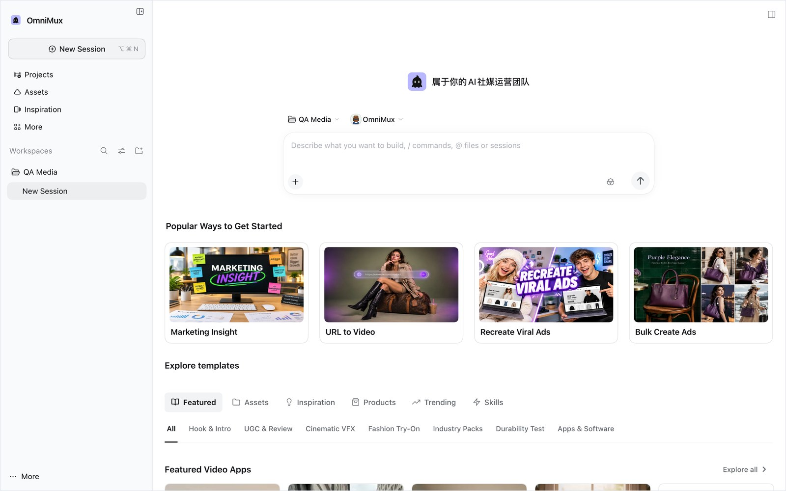
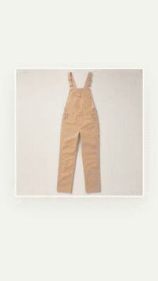
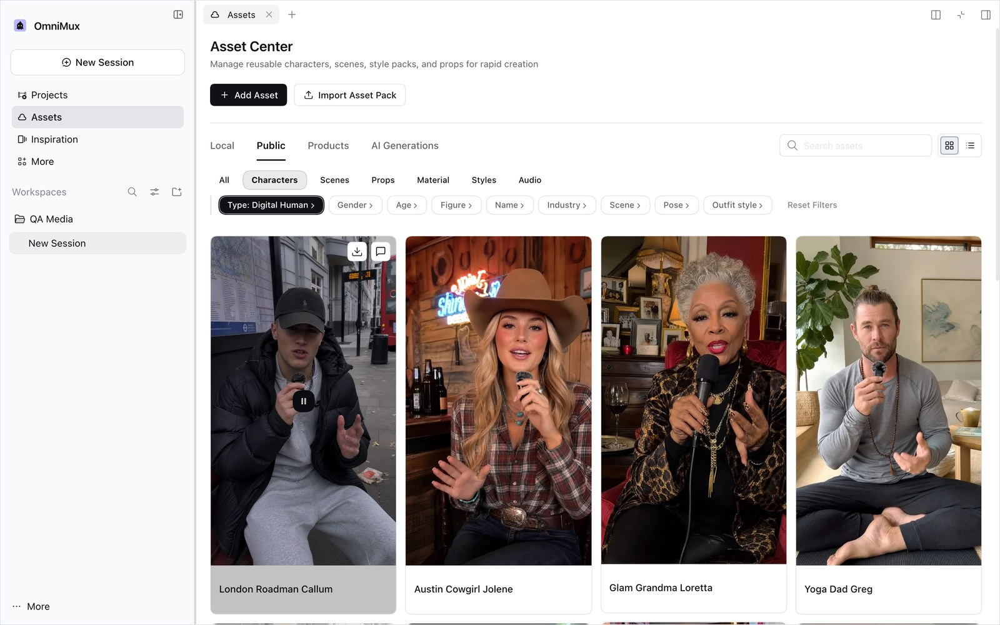
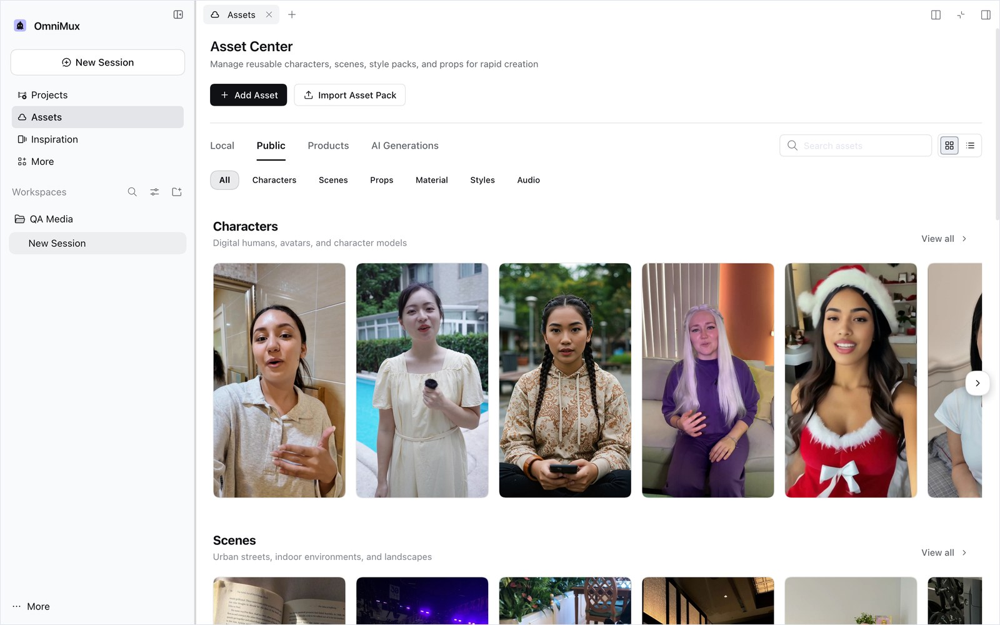
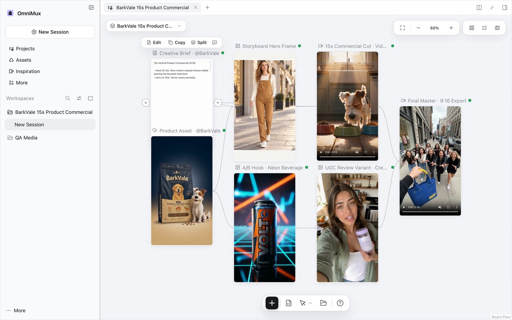
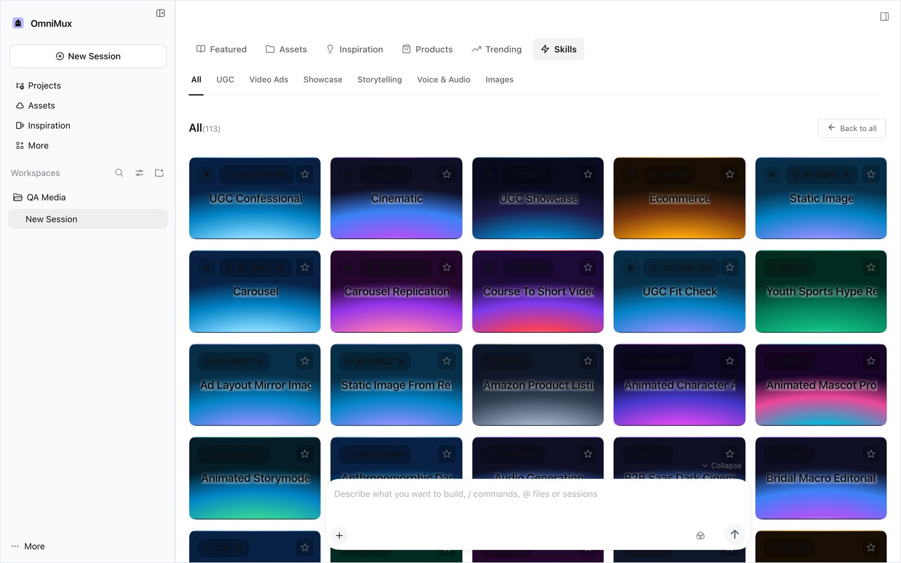
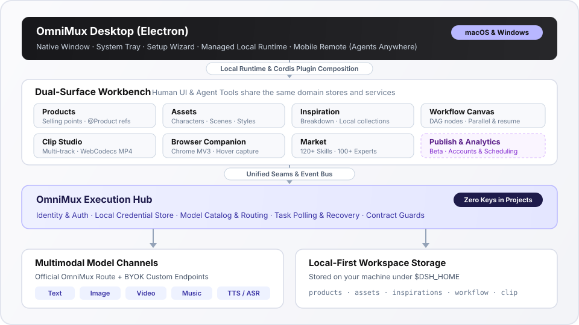

<p align="center">
  <picture>
    <source media="(prefers-color-scheme: dark)" srcset="docs/readme/omnimux-wordmark-dark.svg">
    <source media="(prefers-color-scheme: light)" srcset="docs/readme/omnimux-wordmark-light.svg">
    
  </picture>
</p>

<h1 align="center">OmniMux — Open-Source Local AI Video Studio &amp; Editor for E-Commerce &amp; UGC Ads</h1>

<p align="center">
  <sub>Local-first AI video generator, multimodal workflow canvas, digital human asset library, and multi-track video editor built on DeepSeek Harness — co-edited by you and your AI Agent on macOS &amp; Windows.</sub>
</p>

<p align="center">
  <a href="https://omnimux.ai"></a>
  <a href="#quick-start"></a>
  <a href="https://github.com/omnimux-ai/omnimux-client/actions/workflows/ci.yml"></a>
  <a href="https://github.com/omnimux-ai/omnimux-client/releases/latest"></a>
  <a href="https://github.com/omnimux-ai/omnimux-client/commits/main"></a>
  <a href="LICENSE"></a>
</p>

<p align="center">
  <a href="https://discord.gg/uNPBDz3WNC"></a>
  <a href="https://x.com/OmniMuxai"></a>
  <a href="#community"></a>
  <a href="https://github.com/omnimux-ai/omnimux-client/discussions"></a>
</p>

<p align="center">
  <a href="#quick-start">Quick Start</a> |
  <a href="#showcase">Showcase</a> |
  <a href="#cloud-assets">Cloud Assets</a> |
  <a href="#capabilities">Interface &amp; Capabilities</a> |
  <a href="#ecosystem">Skills &amp; Ecosystem</a> |
  <a href="#models">Models</a> |
  <a href="#architecture">Architecture</a> |
  <a href="#status">Status</a> |
  <a href="#community">Community</a>
</p>

<p align="center">
  <strong>English</strong> | <a href="docs/README.zh-CN.md">简体中文</a>
</p>

<p align="center">
  
</p>
<p align="center">
  <sub>OmniMux Desktop Workbench: Agent chat, quick-start commerce entry points, and Explore templates in one local-first app.</sub>
</p>

---

**OmniMux** is an open-source AI video editor and AI video generator built for **e-commerce product videos, UGC video ads, and short-form video** across TikTok, Reels, and Shorts. Instead of scattered prompts, inconsistent characters/products, and cloud-locked web tools, it unifies your **Product Library, 6,380+ Built-in Cloud & Local Assets, Inspiration Teardown, Infinite Multimodal Canvas, and Multi-Track Clip Studio** into one local-first desktop app on [DeepSeek Harness](https://github.com/deepseek-ai/deepseek-harness), where creators and AI Agents edit the exact same live workspace.

- 🛍️ **Stop re-briefing your product every prompt** — Paste an e-commerce or SaaS landing page to extract selling points and local media refs, save reusable characters/scenes/styles, and mention `@Product` in any chat or canvas.
- ☁️ **6,380+ built-in cloud assets & digital humans out of the box** — Browse 350+ multi-filter digital humans, 3,390+ real-world scenes, 940 product props, 700+ first-3-second viral hooks, 150+ visual style packs, and 610+ voiceover/BGM tracks inside the Asset Center — audition live, save locally in one click, or attach straight into chat and workflows.
- 🔍 **Turn viral short-form & reference videos into briefs** — Capture posts via the Chrome companion, preserve original copy & translations, break down hooks clip-by-clip, and send selected segments straight into a new session.
- 🧩 **Co-edit AI video workflows, lip-sync & timelines with your Agent** — Wire image, video generation, lip-sync, voiceover, and music nodes on a DAG canvas, then refine pacing in the built-in multi-track video editor and export MP4 locally.
- 🔑 **Zero-CLI desktop app with local-first storage & BYOK** — Native macOS and Windows installers bundle the runtime and plugins. Use the unified OmniMux route or bring your own API keys (BYOK) locally.

---

<a id="quick-start"></a>

## ⚡ Download & Quick Start

### 1. Install the Desktop App (No Node.js or CLI required)

| Platform | Direct Download | Installation |
| --- | --- | --- |
| **macOS (Apple Silicon)** | [Download `OmniMux-arm64.dmg`](https://dl.omnimux.ai/releases/latest/OmniMux-arm64.dmg) | Open DMG and drag **OmniMux** into `Applications` |
| **macOS (Intel)** | [Download `OmniMux-x64.dmg`](https://dl.omnimux.ai/releases/latest/OmniMux-x64.dmg) | Open DMG and drag **OmniMux** into `Applications` |
| **Windows (x64)** | [Download `OmniMux-Setup.exe`](https://dl.omnimux.ai/releases/latest/OmniMux-Setup.exe) | Run the installer and follow the setup wizard |

> **Zero-setup runtime & data isolation:** The desktop installers bundle a pinned upstream [DeepSeek Harness](https://github.com/deepseek-ai/deepseek-harness) runtime (`0.2.2-rc.5`) — no prior DSH or Node.js installation is required. OmniMux stores its profiles, sessions, products, and assets locally under `~/.omnimux` and never reads or modifies your existing `~/.dsh` directory.
>
> All release builds and checksums are also published on [GitHub Releases](https://github.com/omnimux-ai/omnimux-client/releases). Visit [omnimux.ai](https://omnimux.ai) for release highlights.

### 2. Produce Your First Product Video in 3 Minutes

Sign in to the OmniMux official route or configure your own model endpoints in **Settings**, then run this loop:

1. **Add a product**: Open **Products → + Add Product**, paste any product landing page URL to extract selling points and media paths, and save.
2. **Generate with `@Product`**: Open a new chat and run a brief:

```text
Using the core selling points from @Product/Your-Product-Name, plan a 15-second vertical product video:
1. Draft the opening 3-second hook and shot-by-shot storyboard;
2. Build the image and video generation nodes on the Workflow Canvas;
3. Send the generated clips into Clip Studio so I can fine-tune captions and pacing and export an MP4.
```

3. **Hand off between UI and AI**: Swap reference frames or rerun a single node directly on the canvas; in Clip Studio, trim manually or click **AI Edit** to pass your active playhead and selection back into chat.

> ⭐ **Useful for your workflow?** [Star OmniMux on GitHub](https://github.com/omnimux-ai/omnimux-client) — it takes 2 seconds and helps more creators and developers find the project.

---

<a id="showcase"></a>

## 🎬 Content Commerce Showcase

Real vertical e-commerce video formats built around product briefs, reusable visual assets, and multimodal workflow templates inside OmniMux:

### Product Commercials & Visual Hooks

<table width="100%">
  <tr>
    <td width="33%" align="center" valign="top">
      <picture>
        <source media="(prefers-reduced-motion: reduce)" srcset="docs/readme/showcase/pet-food-commercial.jpg">
        
      </picture><br>
      <strong>3D VFX Product Spot</strong><br>
      <sub>Dynamic kibble pour transitioning into a warm studio packshot with consistent packaging</sub>
    </td>
    <td width="33%" align="center" valign="top">
      <picture>
        <source media="(prefers-reduced-motion: reduce)" srcset="docs/readme/showcase/apparel-tryon.jpg">
        
      </picture><br>
      <strong>Apparel Runway Try-On</strong><br>
      <sub>Turn a flat-lay garment photo into multi-angle street lookbook motion</sub>
    </td>
    <td width="33%" align="center" valign="top">
      <picture>
        <source media="(prefers-reduced-motion: reduce)" srcset="docs/readme/showcase/energy-drink-ad.jpg">
        
      </picture><br>
      <strong>Beverage Macro Commercial</strong><br>
      <sub>High-contrast condensation macro and kinetic neon lighting for CPG launches</sub>
    </td>
  </tr>
</table>

### UGC Talking-Head & Product Reviews

<table width="100%">
  <tr>
    <td width="33%" align="center" valign="top">
      <picture>
        <source media="(prefers-reduced-motion: reduce)" srcset="docs/readme/showcase/probiotics-ugc.jpg">
        
      </picture><br>
      <strong>Creator Selfie Review</strong><br>
      <sub>First-person kitchen supplement pitch with authentic daylight framing and pack close-up</sub>
    </td>
    <td width="33%" align="center" valign="top">
      <picture>
        <source media="(prefers-reduced-motion: reduce)" srcset="docs/readme/showcase/beauty-lipgloss-ugc.jpg">
        
      </picture><br>
      <strong>Beauty Swatch &amp; Demo</strong><br>
      <sub>On-skin application, wand reveal, and close-up finish proof for cosmetics</sub>
    </td>
    <td width="33%" align="center" valign="top">
      <picture>
        <source media="(prefers-reduced-motion: reduce)" srcset="docs/readme/showcase/skincare-serum-ugc.jpg">
        
      </picture><br>
      <strong>Skincare Talking-Head</strong><br>
      <sub>Window-light serum demonstration keeping bottle branding clear throughout the cut</sub>
    </td>
  </tr>
</table>

### Promo Hooks & Product Walkthroughs

<table width="100%">
  <tr>
    <td width="33%" align="center" valign="top">
      <picture>
        <source media="(prefers-reduced-motion: reduce)" srcset="docs/readme/showcase/headphones-promo.jpg">
        
      </picture><br>
      <strong>Durability &amp; Promo Hook</strong><br>
      <sub>Scroll-stopping street drop-test opening paired with a seasonal campaign callout</sub>
    </td>
    <td width="33%" align="center" valign="top">
      <picture>
        <source media="(prefers-reduced-motion: reduce)" srcset="docs/readme/showcase/totebag-street-hook.jpg">
        
      </picture><br>
      <strong>Viral Street Chase Hook</strong><br>
      <sub>High-energy urban POV opener spotlighting everyday carry accessories</sub>
    </td>
    <td width="33%" align="center" valign="top">
      <picture>
        <source media="(prefers-reduced-motion: reduce)" srcset="docs/readme/showcase/travel-app-demo.jpg">
        
      </picture><br>
      <strong>Interactive App Walkthrough</strong><br>
      <sub>Presenter-led live laptop screen demonstration for apps, software, and digital services</sub>
    </td>
  </tr>
</table>

---

<a id="cloud-assets"></a>

## ☁️ 6,380+ Built-in Cloud Assets

OmniMux ships with a **6,382-item built-in public cloud asset catalog** directly inside **Asset Center → Public** (`omnimux-assets`). Creators and Agents can search, filter across multi-dimensional attributes, audition clips and voices live, save any item to the local Asset Library in one click, or attach it straight into chat and Workflow Canvas nodes without sourcing materials from scratch.

| Category | Built-in Items | Sub-Categories & Key Highlights |
| --- | :---: | --- |
| **Characters & Digital Humans** | **423** | **353 Digital Humans** filterable across **9 dimensions** (Type, Gender, Age, Figure, Name, Industry, Scene, Pose, Outfit Style), plus Meme (25), Fantasy (25), and Animal (20) characters |
| **Real-World Scenes** | **3,396** | Leisure (1,051), Nature (538), City Streets (511), Travel & Car (504), Indoor Living (449), and Workplace (343) environments |
| **Product & Commerce Props** | **940** | Books & Stationery (488), 3C Digital (172), Food & Drinks (124), Beauty & Care (114), and Instruments & Toys (42) |
| **Hooks & Video Materials** | **855** | **705 First-3-Second Viral Hooks** and **150 Dynamic Green-Screen Clips** ready for drop-in openings |
| **Audio, Voices & BGM** | **617** | **509 Voiceovers**, **103 BGM Tracks**, and **5 SFX** with instant hover audition |
| **Visual Style Packs** | **151** | Live Action (35), 2D Anime (35), 3D Render (35), Mood & Tone (35), Photography (7), and Traditional Art (4) |

<p align="center">
  
</p>
<p align="center">
  <sub><strong>Built-in Digital Humans (Public → Characters):</strong> Filter 353+ realistic speaking avatars across 9 attributes, audition on hover, save to local library, or send straight to Agent chat.</sub>
</p>

<table width="100%">
  <tr>
    <td width="50%" align="center" valign="top">
      <br>
      <strong>Public Cloud Asset Center Overview</strong><br>
      <sub>Browse all six curated asset categories directly inside the desktop app with instant search and category tabs</sub>
    </td>
    <td width="50%" align="center" valign="top">
      <br>
      <strong>3,396 Real-World Scenes &amp; 940 Commerce Props</strong><br>
      <sub>Ready-to-use urban, indoor, lifestyle, and tabletop backdrops plus physical product display props</sub>
    </td>
  </tr>
</table>

---

<a id="capabilities"></a>
<a id="interface"></a>

## ✨ Interface & Dual-Surface Workbench

Every core OmniMux module ships with a **dual surface**: a visual interface for direct control and matching Agent tools backed by the exact same local store, schema validation, and undo/recovery logic.

| Module | What you can do directly | How your Agent collaborates |
| --- | --- | --- |
| **Product Library** (`omnimux-products`) | Paste landing pages to parse selling points, audience & pricing; preview desktop/mobile captures; bind local media via read-only path refs (never moves or deletes originals) | Read structured product profiles via `@Product` so hooks, scripts, and visual prompts stay factually consistent |
| **Creative Asset Center** (`omnimux-assets`) | Browse **6,380+ built-in cloud assets** (Digital Humans, Scenes, Props, Hooks, Styles, Audio) with one-click local save, and organize your own local **Characters, Scenes, Style Packs, Props, Knowledge Packs, and Custom** refs | Search both cloud and local libraries, save selected cloud assets locally, and inject pinned `@Asset` references into storyboards and generation nodes |
| **Inspiration & Browser Companion** (`omnimux-inspiration`, `omnimux-browser`) | Hover-capture media with the Chrome MV3 extension over a local authenticated WebSocket bridge; organize local collections with original copy + translations | Break down whole posts, copy, or single clips into structured hooks and attach selected segments into a new session |
| **Infinite Workflow Canvas** (`omnimux-workflow`) | Drag and wire prompt, reference image, first/last-frame video, lip-sync, and music nodes on a DAG canvas; run full graphs, subgraphs, or single nodes with checkpoint recovery | Inspect live canvas snapshots, add/update/connect nodes, switch verified model lines, and monitor long-running jobs |
| **Clip Studio** (`omnimux-clip`) | Edit on a three-pane multi-track timeline, inspect real composited frames, and export MP4 locally via WebCodecs/WebGPU | Receive active project, revision, playhead, and selection via **AI Edit**; apply batched timeline edits with single-step undo and explicit export confirmation |

> Opening a `video_composition` node on the canvas opens Clip Studio bound to that node; exporting a new MP4 writes the revision straight back to downstream canvas nodes automatically.

### Infinite Multimodal Workflow Canvas

Wire briefs, product references, storyboard frames, A/B hooks, video generation nodes, and final export cuts on one visual DAG co-edited by you and your Agent:

<p align="center">
  
</p>

### Creative Asset Center & Featured Video Apps

Organize reusable **Characters, Scenes, Style Packs, and Props** locally in the Asset Center, and launch vertical commerce formats straight from Explore Templates & Featured Video Apps:

<p align="center">
  
</p>

<p align="center">
  
</p>

---

<a id="ecosystem"></a>

## 🧩 Skills, Plugins & AI Agent Ecosystem

OmniMux is built on [DeepSeek Harness](https://github.com/deepseek-ai/deepseek-harness) and designed to be extended by creators, growth teams, and plugin developers:

- **Built-in Skill & Expert Market (`omnimux-market`)**: Ships with **120+ curated content-commerce Skills** (UGC hooks, product shoots, video recreation, static ads, carousels, scripts), **100+ Expert presets**, and **12 MCP connectors** ready to browse and install inside the app.
- **Standard `SKILL.md` Authoring**: Package repeatable creative playbooks or team SOPs as standard `SKILL.md` directories — see [`plugins/plugins/omnimux-market/README.md`](plugins/plugins/omnimux-market/README.md) and [`plugins/docs/contracts/plugin-agent-tools-inventory.md`](plugins/docs/contracts/plugin-agent-tools-inventory.md).
- **Composable Cordis Plugins**: Every workbench module (`omnimux-workflow`, `omnimux-clip`, `omnimux-products`, etc.) is a modular plugin consuming shared UI primitives (`plugins/packages/dsh-ui-kit`) and Hub seams — see [Plugin Development](app/docs/plugin-development.en.md).
- **Native Desktop & Mobile Remote**: Managed local runtime, first-run Setup Wizard, system tray controls, and built-in **Agents Anywhere** support to monitor renders and send follow-ups from iOS or Android.

<p align="center">
  
</p>

---

<a id="models"></a>

## 🎛️ Multimodal Models & Flexible Routing

The **OmniMux Execution Hub (`omnimux`)** centralizes auth, local credential storage, model discovery, parameter validation, and long-running task recovery across all plugins:

- **OmniMux Official Route**: Sign in once for unified access across text, image, video, music, and speech models.
- **BYOK (Bring Your Own Keys)**: Configure OpenAI-compatible or custom media provider endpoints in Settings; keys stay in local storage and are never written into project or canvas files.

| Modality | Supported Model Families | Typical Tasks |
| --- | --- | --- |
| **💬 Text & Multimodal Reasoning** | DeepSeek V4, Claude, GPT-5, Gemini, Grok, Kimi, GLM | Selling-point extraction, teardown, scriptwriting, Agent tool orchestration |
| **🖼️ Image Generation & Editing** | GPT Image 2.5, Nano Banana 2 / Pro, Seedream 5.0 Pro, Midjourney, Grok Imagine | Product visuals, character sheets, multi-reference storyboard frames |
| **🎬 Video Generation** | Seedance 2.0 / 2.5, Kling V2.6 / V3 / O3, Wan 3.0, MiniMax H3, Grok Imagine Video | Text-to-video, first/last frame, multi-reference, video extend, lip-sync |
| **🎵 Music & Speech** | Suno Music, Gemini TTS, Seed Audio, Index TTS2 voice cloning, Whisper / Doubao ASR | Custom BGM, voiceovers, speech-to-text transcripts |

> Available models, aspect ratios, durations, and reference limits come dynamically from your active route catalog and are validated before submission.

---

<a id="architecture"></a>

## 🏗️ Architecture & Local Development

OmniMux develops and ships its Electron desktop shell (`app/`) and product plugin suite (`plugins/`) in one monorepo. Domain plugins never hold provider credentials or call upstream APIs directly — all model execution flows through the Execution Hub.

**Upstream layering & boundaries:** OmniMux runs a pinned, unmodified upstream [DeepSeek Harness](https://github.com/deepseek-ai/deepseek-harness) runtime (`0.2.2-rc.5`, tracked as `app/deepseek-harness`) for core Agent loops, sessions, and the [Cordis](https://github.com/cordiverse/cordis) plugin host; builds its native desktop shell on [DSH Desktop](https://github.com/anywhere-labs/deepseek-harness-desktop); and owns the content commerce workbench plugins, Execution Hub, asset catalog, and standalone packaging (`~/.omnimux` data root).

<p align="center">
  
</p>

<details>
<summary>View architecture diagram as text &amp; repository layout</summary>

```text
+-----------------------------------------------------------------------+
|                       OmniMux Desktop (Electron)                      |
|   Native Window | System Tray | Setup Wizard | Managed Local Runtime  |
+-----------------------------------+-----------------------------------+
                                    |
                    Local Runtime & Cordis Composition
                                    |
+-----------------------------------+-----------------------------------+
|          Dual-Surface Workbench (Human UI + Agent Tools)              |
|  Products | Assets | Inspiration | Workflow | Clip | Browser | Market |
+-----------------------------------+-----------------------------------+
                                    |
                        Unified Seams & Event Bus
                                    |
+-----------------------------------+-----------------------------------+
|                        OmniMux Execution Hub                          |
|  Auth | Local Credentials | Model Routing | Task Recovery | Guards    |
+------------------+---------------------------------+------------------+
                   |                                 |
                   v                                 v
      Official Route / BYOK Endpoints     Local-First Storage (~/.omnimux)
     (Text | Image | Video | Music | TTS) (products | assets | workflow | clip)
```

```text
omnimux-client/
├── app/                     # Electron desktop shell (Yarn 4 workspace, installers & native integration)
│   ├── dsh-desktop-next/    # OmniMux native desktop shell
│   ├── dsh-plugin-desktop/  # Desktop capability plugin (window, tray, profiles, updates)
│   ├── config/              # Plugin release tiers (plugin-tiers.json)
│   └── docs/                # User guide, FAQ, and desktop architecture docs
├── plugins/                 # Product plugin workspace (root pnpm workspace)
│   ├── packages/            # Shared UI kit (dsh-ui-kit) and shared contracts
│   ├── plugins/             # Execution Hub and 12 domain plugins
│   └── docs/contracts/      # Agent tool inventory, canvas generation, and clip contracts
├── docs/                    # Repository documentation & subsystem index
└── scripts/                 # Workspace consistency checks and build helpers
```

</details>

### Build from Source

Prerequisites: **Node.js `^22.19 || >=24`** and **Corepack** (manages pnpm and Yarn 4 automatically).

```bash
git clone https://github.com/omnimux-ai/omnimux-client.git && cd omnimux-client
git submodule update --init --recursive
corepack enable && corepack pnpm install --frozen-lockfile && corepack pnpm --dir plugins run build:all
node scripts/workspace-check.mjs --check
cd app && corepack yarn install --immutable && corepack yarn dev
```

<details>
<summary>Documentation &amp; Engineering Contracts</summary>

| Audience | Links |
| --- | --- |
| **Users** | [User Guide](app/docs/user-guide.en.md) | [FAQ](app/docs/faq.en.md) | [Privacy Policy](PRIVACY.md) |
| **Desktop & Plugin Developers** | [Desktop Subtree README](app/README.en.md) | [Plugins Subtree README](plugins/README.md) | [Desktop Architecture](app/docs/architecture.en.md) | [Plugin Development](app/docs/plugin-development.en.md) |
| **Contracts & Specs** | [Agent Tool Inventory](plugins/docs/contracts/plugin-agent-tools-inventory.md) | [Canvas Generation Contract](plugins/docs/contracts/canvas-generation.md) | [Clip Live Control Contract](plugins/docs/contracts/clip-live-control.md) | [Subsystem Index](docs/subsystems.md) |

</details>

---

<a id="status"></a>

## 🧭 Current Status & Roadmap

Release maturity is tracked directly in [`app/config/plugin-tiers.json`](app/config/plugin-tiers.json):

| Area | Status | Notes |
| --- | --- | --- |
| **Native Desktop App** | `Released` | macOS (Apple Silicon & Intel) and Windows (x64) installers, Setup Wizard, auto-updates, and mobile remote control |
| **Execution Hub & Model Routing** | `Preview` | Account login, official route & BYOK endpoints, unified multimodal generation, and timeout recovery |
| **Product & Creative Asset Libraries** | `Preview` | Landing-page parsing, `@Product` mentions, six local asset types, and 6,380+ built-in cloud assets (digital humans, scenes, props, hooks, styles & audio) |
| **Inspiration Library & Browser Companion** | `Preview` | Post import, original copy & translation preservation, per-object breakdown, local collections, and Chrome hover capture |
| **Infinite Canvas & Clip Studio** | `Preview` | Visual DAG orchestration, subgraph/checkpoint execution, multi-track timeline editing, AI Edit bridge, and local MP4 export |
| **Plugin & Skill Market** | `Preview` | 120+ built-in skills, 100+ experts, plugins, and 12 MCP connectors |
| **Accounts, Publishing & Analytics** | `Beta` | `omnimux-accounts`, `omnimux-publish`, `omnimux-analytics`, and `omnimux-video` for international channel scheduling and review |
| **Upcoming Direction** | `Planned` | Team asset & knowledge collaboration, broader commerce connectors, and performance-linked production feedback loops |

> **Scope notice:** OmniMux does not currently provide automated publishing to domestic Chinese social platforms (Douyin, Xiaohongshu, WeChat Channels, Kuaishou, Bilibili), nor does it guarantee viral reach, ad conversions, or account standing.

---

<a id="community"></a>

## 💬 Community & Contributing

PRs, bug reports, workflow templates, and new `SKILL.md` skills are welcome — see [CONTRIBUTING.md](CONTRIBUTING.md) to get started.

- **GitHub Discussions** — Q&A, workflow showcase, and open-ended ideas: [Join Discussions](https://github.com/omnimux-ai/omnimux-client/discussions)
- **GitHub Issues** — Bug reports, feature requests, and skill/plugin proposals: [Open an Issue](https://github.com/omnimux-ai/omnimux-client/issues/new/choose)
- **Discord & X** — Real-time community chat and release announcements: [Discord](https://discord.gg/uNPBDz3WNC) | [@OmniMuxai](https://x.com/OmniMuxai)
- **Security & Commercial** — Private vulnerability reports ([SECURITY.md](SECURITY.md)) and licensing inquiries: `hello@omnimux.ai`

<table>
  <thead>
    <tr>
      <th align="center" width="50%">WeChat / WeCom Group</th>
      <th align="center" width="50%">Global Channels</th>
    </tr>
  </thead>
  <tbody>
    <tr>
      <td align="center" valign="middle">
        <br>
        <sub>Scan with WeChat or WeCom to join the <strong>OmniMux Community Group</strong></sub>
      </td>
      <td align="center" valign="middle">
        <p><a href="https://discord.gg/uNPBDz3WNC"></a></p>
        <p><a href="https://x.com/OmniMuxai"></a></p>
        <p><a href="https://github.com/omnimux-ai/omnimux-client/discussions"></a></p>
        <sub>Guidelines: <a href="CONTRIBUTING.md">Contributing</a> | <a href="CODE_OF_CONDUCT.md">Code of Conduct</a> | <a href="SECURITY.md">Security</a></sub>
      </td>
    </tr>
  </tbody>
</table>

---

## 📄 License & Commercial Licensing

Code authored by the OmniMux project is licensed under **[AGPL-3.0](LICENSE)** with the Section 7 attribution terms in [NOTICE](NOTICE). Commercial licensing is also available:

| Use Case | AGPL-3.0 (Free) | Commercial License |
| :--- | :---: | :---: |
| Use, modify, and self-host for individuals, teams, or businesses (including commercial use) | ✅ | ✅ |
| Modify and distribute or offer as a network service while publishing modified source code | ✅ | ✅ |
| Modify and distribute or offer as a service without publishing modified source code | ❌ | ✅ |
| Remove `Powered by OmniMux` attribution or ship under a white-label brand | ❌ | ✅ |

- Commercial licensing inquiries: `hello@omnimux.ai`.
- Third-party open-source components retain their original licenses and copyright notices; see [NOTICE](NOTICE), [`app/LICENSE`](app/LICENSE), [`plugins/ACKNOWLEDGEMENTS.md`](plugins/ACKNOWLEDGEMENTS.md), and [`app/dsh-plugin-desktop/THIRD_PARTY_NOTICES.md`](app/dsh-plugin-desktop/THIRD_PARTY_NOTICES.md).
- Companion server repository: [`omnimux-ai/omnimux-gateway`](https://github.com/omnimux-ai/omnimux-gateway).

---

<a id="acknowledgments"></a>

## 🙏 Acknowledgments

OmniMux is built with the help of the global open-source community. Every third-party component retains its original license and copyright notices:

- **Core Runtime & Plugin Foundation**: [DeepSeek Harness](https://github.com/deepseek-ai/deepseek-harness) (MIT, by the DeepSeek AI team) for the Agent runtime, session loop, and tool host, alongside [Cordis](https://github.com/cordiverse/cordis) (MIT) and the [Koishi.js](https://koishi.chat/) community. OmniMux bundles a pinned upstream DeepSeek Harness runtime (`0.2.2-rc.5`) unmodified.
- **Desktop Shell & Workbench Subsystems**: [Anywhere Labs / DSH Desktop](https://github.com/anywhere-labs/deepseek-harness-desktop) (desktop shell foundation, MIT), [Augani / OpenReel Video](https://github.com/Augani/openreel-video) (multi-track NLE engine, MIT), [@cocofhu / SkillHub](https://github.com/cocofhu/skillhub) (plugin & skill market base, MIT), [Yuxiang Lin / dsh-browser](https://github.com/omdsh-dev/dsh-browser) (browser companion, MIT), [BeefTV Director](https://github.com/glanderness/BeefTV) (pinned MIT revision `5e2ad602`), [Quaternius](https://quaternius.itch.io/universal-base-characters) (CC0 1.0 3D actor models), and [Crosery / dsh-viewer](https://github.com/Crosery/dsh-viewer) (historical media-renderer attribution, MIT).
- **Key Open-Source Libraries**: [React Flow](https://github.com/xyflow/xyflow), [Dagre](https://github.com/dagrejs/dagre), [Umami](https://github.com/umami-software/umami), and every community contributor who builds skills, reports bugs, or improves OmniMux.

For full provenance, pinned revisions, and third-party license texts, see [NOTICE](NOTICE), [`plugins/ACKNOWLEDGEMENTS.md`](plugins/ACKNOWLEDGEMENTS.md), and [`app/dsh-plugin-desktop/THIRD_PARTY_NOTICES.md`](app/dsh-plugin-desktop/THIRD_PARTY_NOTICES.md).

---

<a id="disclaimer"></a>

## ⚖️ Disclaimer

- **Independent Project & Trademarks**: OmniMux is an independent open-source project and is **not affiliated with, authorized by, or endorsed by DeepSeek**, Anywhere Labs, or any third-party model provider or social media platform mentioned in this repository. Upstream contributors appearing in Git history come from inherited upstream commits and do not imply their participation in or endorsement of OmniMux. All third-party product names, logos, and trademarks belong to their respective owners and are used solely to identify dependencies and compatibility.
- **AI-Generated Content & IP Responsibility**: OmniMux is a local-first authoring and orchestration workbench. Output produced by third-party or official AI models (copy, images, audio, digital humans, and video) may be inaccurate or require review before publication. You are solely responsible for verifying product claims, advertising compliance, and copyright, trademark, portrait, and voice rights before publishing or commercializing generated media.
- **Third-Party Services & Platform Terms**: When using landing-page parsing, inspiration import, the browser companion, BYOK endpoints, or international social scheduling, you are responsible for complying with the terms of service of target websites/platforms and applicable laws. OmniMux does not provide automated publishing to domestic Chinese social platforms (Douyin, Xiaohongshu, WeChat Channels, Kuaishou, Bilibili) and makes no guarantees regarding reach, conversions, or account standing.
- **As-Is Warranty Disclaimer**: This software is provided "AS IS" without warranty of any kind under [AGPL-3.0](LICENSE). To the maximum extent permitted by applicable law, the authors and contributors are not liable for any claim, damages, or other liability arising from use of this software. For privacy, copyright, attribution, or compliance inquiries, see [PRIVACY.md](PRIVACY.md) or contact `hello@omnimux.ai`.

---

<details>
<summary>🇨🇳 中文简介与搜索索引（查看完整中文文档：docs/README.zh-CN.md）</summary>

**OmniMux** 是一款开源本地优先的 **AI 电商带货与 UGC 短视频工作台**（macOS / Windows），基于 DeepSeek Harness 构建，将商品库、6,380+ 云端与本地数字人/场景/道具/前 3 秒钩子资产库、Chrome 爆款灵感拆解、多模态无限工作流画布、对口型与多轨视频剪辑工坊整合在同一客户端中，支持官方统一路由与 BYOK 自定义模型密钥。完整安装说明、案例展示与开发文档请参阅 [简体中文 README](docs/README.zh-CN.md)。

</details>

---

## ⭐ Star History

<a href="https://www.star-history.com/#omnimux-ai/omnimux-client&Date">
 <picture>
   <source media="(prefers-color-scheme: dark)" srcset="https://api.star-history.com/svg?repos=omnimux-ai/omnimux-client&type=Date&theme=dark" />
   <source media="(prefers-color-scheme: light)" srcset="https://api.star-history.com/svg?repos=omnimux-ai/omnimux-client&type=Date" />
   
 </picture>
</a>

<p align="center">
  <sub>Copyright © 2026 OmniMux Project and Contributors.</sub>
</p>
