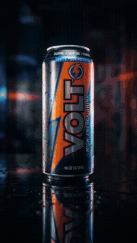
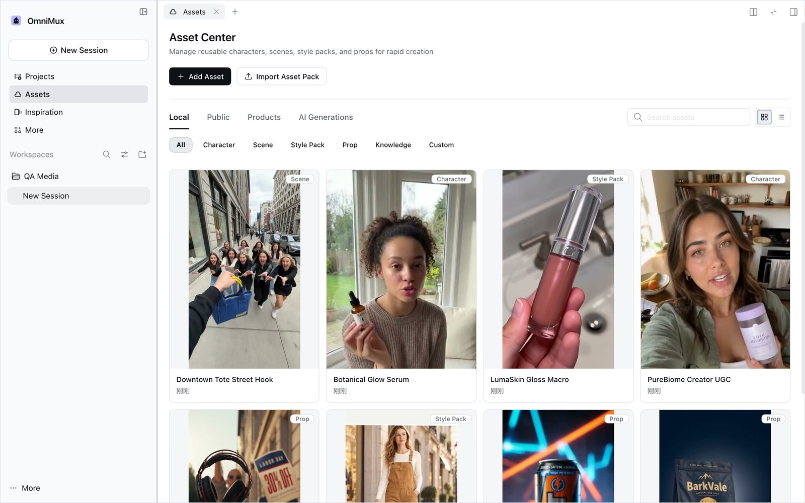
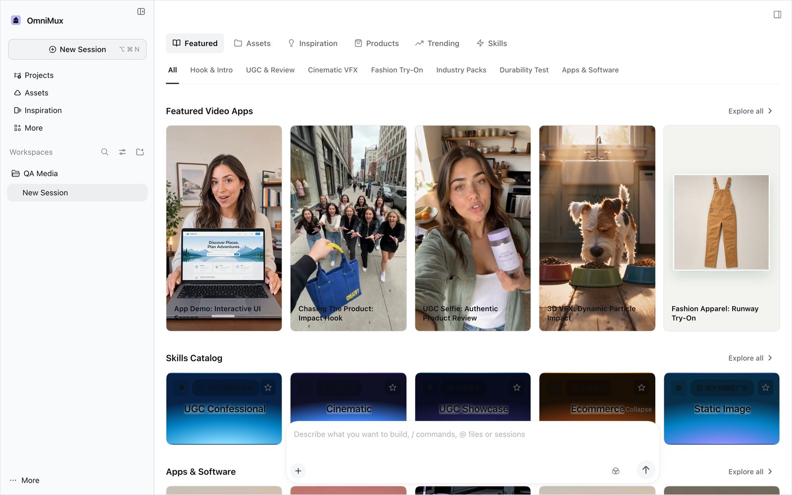

<p align="center">
  <picture>
    <source media="(prefers-color-scheme: dark)" srcset="docs/readme/omnimux-wordmark-dark.svg">
    <source media="(prefers-color-scheme: light)" srcset="docs/readme/omnimux-wordmark-light.svg">
    
  </picture>
</p>

<p align="center">
  <strong>Your Local AI Content Commerce Team</strong><br>
  <sub>A local-first desktop Agent workbench that keeps your product selling points and brand assets consistent across every video</sub>
</p>

<p align="center">
  <a href="https://omnimux.ai"></a>
  <a href="https://dl.omnimux.ai"></a>
  <a href="https://github.com/omnimux-ai/omnimux-client/releases/latest"></a>
  <a href="https://github.com/omnimux-ai/omnimux-client"></a>
  <a href="LICENSE"></a>
</p>

<p align="center">
  <a href="https://discord.gg/omnimux"></a>
  <a href="https://x.com/omnimux_ai"></a>
  <a href="#community"></a>
  <a href="https://github.com/omnimux-ai/omnimux-client/discussions"></a>
</p>

<p align="center">
  <a href="#quick-start">Download</a> ·
  <a href="#showcase">Showcase</a> ·
  <a href="#capabilities">Interface &amp; Capabilities</a> ·
  <a href="#models">Models</a> ·
  <a href="#architecture">Architecture &amp; Dev</a> ·
  <a href="#status">Status</a> ·
  <a href="#community">Community</a>
</p>

<p align="center">
  <strong>English</strong> · <a href="docs/README.zh-CN.md">简体中文</a>
</p>

<p align="center">
  
</p>
<p align="center">
  <sub>OmniMux Desktop Workbench: Agent chat, quick-start commerce entry points, and Explore templates in one local-first app.</sub>
</p>

---

# OmniMux

**OmniMux** is an open-source, local-first **AI content commerce desktop workbench**. It brings your product catalog, visual assets, inspiration teardown, multimodal workflow canvas, and multi-track video timeline together inside one desktop app where both you and your Agent operate on the same live workspace.

- 🛍️ **Keep product selling points in every cut.** Paste a product landing page to populate selling points, target audience, and media paths in your local Product Library, and organize reusable characters, scenes, styles, and props in the Asset Library. Mention `@Product` in chat or workflows without re-briefing from scratch.
- 🔍 **Turn social inspiration into structured production briefs.** Capture media directly from your browser companion, keep original copy and translations in the Inspiration Library, break down posts by whole post, copy, or single clip, and attach selected segments into a new session.
- 🧩 **Infinite multimodal canvas + multi-track timeline, co-edited by humans and Agents.** Wire text, reference images, video generation, lip-sync, music, and voiceover nodes on a visual DAG canvas, then open the built-in multi-track Clip Studio to refine timing and export MP4 locally. Manual edits and Agent tool calls share one underlying project state.
- 🔑 **Ready-to-run desktop app with local-first data & BYOK.** Install native macOS or Windows builds with no Node.js or CLI setup required. Sign in to the OmniMux official route for unified multimodal access, or bring your own API keys (BYOK) while keeping credentials and workspace files on your machine.

---

<a id="quick-start"></a>

## ⚡ Download & Quick Start

### 1. Download the Desktop App (Recommended)

The native desktop installer bundles the runtime and core content commerce plugin suite—install and launch without configuring Node.js or terminal tooling.

| Platform | Official Download | Installation |
| --- | --- | --- |
| **macOS (Apple Silicon)** | [Download `OmniMux-arm64.dmg`](https://dl.omnimux.ai/releases/latest/OmniMux-arm64.dmg) | Open the DMG and drag OmniMux into `Applications` |
| **macOS (Intel)** | [Download `OmniMux-x64.dmg`](https://dl.omnimux.ai/releases/latest/OmniMux-x64.dmg) | Open the DMG and drag OmniMux into `Applications` |
| **Windows (x64)** | [Download `OmniMux-Setup.exe`](https://dl.omnimux.ai/releases/latest/OmniMux-Setup.exe) | Run the installer and follow the setup prompts |

> Release history and installers are also published on [GitHub Releases](https://github.com/omnimux-ai/omnimux-client/releases). Visit [omnimux.ai](https://omnimux.ai) for product updates.

### 2. Produce Your First Product Video in 3 Minutes

After installing, sign in to your OmniMux account or configure your own model endpoints in Settings, then try this workflow:

1. **Add a product**: Open **Products → + Add Product** in the sidebar, paste any product landing page URL to extract selling points and product media, and save.
2. **Start creating**: Open a new conversation, reference your product with `@Product`, and run a brief like:

```text
Using the core selling points from @Product/Your-Product-Name, plan a 15-second vertical product video:
1. Draft the opening 3-second hook and shot-by-shot storyboard;
2. Build the image and video generation nodes on the Workflow Canvas;
3. Send the generated clips into Clip Studio so I can fine-tune captions and pacing and export an MP4.
```

3. **Collaborate across UI and chat**: Swap reference images or rerun a single node directly on the canvas; inside Clip Studio, trim manually on the timeline or click **AI Edit** in the top bar to continue editing the active project, playhead, and selection through chat.

---

<a id="showcase"></a>
<a id="use-cases"></a>

## 🎬 Content Commerce Showcase

Real vertical e-commerce video formats built around product briefs, reusable visual assets, and multimodal workflow templates inside OmniMux:

### Product Commercials & Visual Hooks

<table width="100%">
  <tr>
    <td width="33%" align="center" valign="top">
      <picture>
        <source media="(prefers-reduced-motion: reduce)" srcset="docs/readme/showcase/pet-food-commercial.jpg">
        
      </picture><br>
      <strong>3D VFX Product Spot</strong><br>
      <sub>Dynamic kibble pour transitioning into a warm studio packshot with consistent packaging</sub>
    </td>
    <td width="33%" align="center" valign="top">
      <picture>
        <source media="(prefers-reduced-motion: reduce)" srcset="docs/readme/showcase/apparel-tryon.jpg">
        
      </picture><br>
      <strong>Apparel Runway Try-On</strong><br>
      <sub>Turn a flat-lay garment photo into multi-angle street lookbook motion</sub>
    </td>
    <td width="33%" align="center" valign="top">
      <picture>
        <source media="(prefers-reduced-motion: reduce)" srcset="docs/readme/showcase/energy-drink-ad.jpg">
        
      </picture><br>
      <strong>Beverage Macro Commercial</strong><br>
      <sub>High-contrast condensation macro and kinetic neon lighting for CPG launches</sub>
    </td>
  </tr>
</table>

### UGC Talking-Head & Product Reviews

<table width="100%">
  <tr>
    <td width="33%" align="center" valign="top">
      <picture>
        <source media="(prefers-reduced-motion: reduce)" srcset="docs/readme/showcase/probiotics-ugc.jpg">
        
      </picture><br>
      <strong>Creator Selfie Review</strong><br>
      <sub>First-person kitchen supplement pitch with authentic daylight framing and pack close-up</sub>
    </td>
    <td width="33%" align="center" valign="top">
      <picture>
        <source media="(prefers-reduced-motion: reduce)" srcset="docs/readme/showcase/beauty-lipgloss-ugc.jpg">
        
      </picture><br>
      <strong>Beauty Swatch &amp; Demo</strong><br>
      <sub>On-skin application, wand reveal, and close-up finish proof for cosmetics</sub>
    </td>
    <td width="33%" align="center" valign="top">
      <picture>
        <source media="(prefers-reduced-motion: reduce)" srcset="docs/readme/showcase/skincare-serum-ugc.jpg">
        
      </picture><br>
      <strong>Skincare Talking-Head</strong><br>
      <sub>Window-light serum demonstration keeping bottle branding clear throughout the cut</sub>
    </td>
  </tr>
</table>

### Promo Hooks & Product Walkthroughs

<table width="100%">
  <tr>
    <td width="33%" align="center" valign="top">
      <picture>
        <source media="(prefers-reduced-motion: reduce)" srcset="docs/readme/showcase/headphones-promo.jpg">
        
      </picture><br>
      <strong>Durability &amp; Promo Hook</strong><br>
      <sub>Scroll-stopping street drop-test opening paired with a seasonal campaign callout</sub>
    </td>
    <td width="33%" align="center" valign="top">
      <picture>
        <source media="(prefers-reduced-motion: reduce)" srcset="docs/readme/showcase/totebag-street-hook.jpg">
        
      </picture><br>
      <strong>Viral Street Chase Hook</strong><br>
      <sub>High-energy urban POV opener spotlighting everyday carry accessories</sub>
    </td>
    <td width="33%" align="center" valign="top">
      <picture>
        <source media="(prefers-reduced-motion: reduce)" srcset="docs/readme/showcase/travel-app-demo.jpg">
        
      </picture><br>
      <strong>Interactive App Walkthrough</strong><br>
      <sub>Presenter-led live laptop screen demonstration for apps, software, and digital services</sub>
    </td>
  </tr>
</table>

---

<a id="capabilities"></a>
<a id="interface"></a>

## ✨ Interface & Core Workbench Capabilities

### 1. Product Library & Creative Asset Center

Keep business facts and reusable visual materials structured on disk so you never lose consistency between runs:

- **Product Library (`omnimux-products`)**: Built for sellable products with landing-page link parsing, desktop/mobile capture preview, selling-point and audience fields, and read-only path references that never move or delete your original files.
- **Creative Asset Center (`omnimux-assets`)**: Organize reusable local objects across six categories—**Character, Scene, Style Pack, Prop, Knowledge Pack, and Custom**—with multi-angle asset management alongside a browsable cloud asset catalog.

<p align="center">
  
</p>

### 2. Explore Templates, Featured Video Apps & Inspiration

Turn proven content formats and everyday research into structured creative context:

- **Featured Video Apps & Templates**: Browse vertical commerce apps by format—**Hook & Intro, UGC & Review, Cinematic VFX, Fashion Try-On, Durability Test, and Apps & Software**—and jump straight into guided creation.
- **Inspiration Library (`omnimux-inspiration`)**: Preserves original post copy, separate translations, and multi-media items; supports targeted analysis by **whole post, body text, or individual media**, drag-and-drop local collections, and one-click attachment of prepared clips and notes into chat.
- **Browser Companion (`omnimux-browser`)**: A Chrome Manifest V3 extension paired over a local authenticated WebSocket bridge, offering hover media capture capsules, structured page reading, and a browser side-panel chat synchronized with your desktop model catalog.

<p align="center">
  
</p>

### 3. Infinite Workflow Canvas & Video Clip Studio

Every core workbench capability ships with a **dual surface**: a visual interface for direct manipulation and matching Agent tools backed by the exact same store and validation logic.

<p align="center">
  
</p>

| Workbench | What you can do directly | How your Agent collaborates |
| --- | --- | --- |
| **Workflow Canvas (`omnimux-workflow`)** | Drag and wire material & generation nodes, manage ordered reference slots, run full graphs, subgraphs, or single nodes, undo/redo, and resume interrupted executions | Inspect live canvas snapshots, add/update/connect/remove nodes, switch verified model lines, and run or track workflow jobs |
| **Clip Studio (`omnimux-clip`)** | Edit on a three-pane multi-track timeline, inspect real composited frames, and export MP4 locally with WebCodecs/WebGPU | Click **AI Edit** to pass active project, revision, playhead, and selection context to chat; apply batched edits with single-step undo and explicit export confirmation |

> Opening a `video_composition` node on the canvas launches Clip Studio bound to that workspace and node; once exported, the new MP4 revision commits back to the canvas as a downstream node automatically.

### 4. Built-in Skills Catalog, Plugin Market & Native Desktop Experience

- **Plugin & Skill Market (`omnimux-market`)**: Ships with **110+ ready-to-use content commerce and marketing Skills** (UGC & testimonials, video ads, static ad creatives, product showcases, storytelling, voice & audio) and **100+ Expert presets**, plus searchable plugins and MCP connectors.
- **Native Desktop & Mobile Remote**: Managed local runtime, first-run Setup Wizard, system tray controls, and built-in **Agents Anywhere** support so you can check production progress and send follow-ups from iOS or Android.

<p align="center">
  
</p>

---

<a id="models"></a>

## 🎛️ Multimodal Models & Flexible Routing

The **OmniMux Execution Hub (`omnimux`)** centralizes authentication, credential storage, model discovery, and long-running media task polling/recovery across all workbench plugins:

- **OmniMux Official Route**: Sign in once to access a unified multimodal catalog across text, image, video, music, and speech models.
- **BYOK (Bring Your Own Keys)**: Configure custom OpenAI-compatible or media provider endpoints in Settings; credentials remain in local storage and are never written into project or canvas files.

| Modality | Supported Model Families | Typical Tasks |
| --- | --- | --- |
| **💬 Text & Multimodal Reasoning** | DeepSeek V4, Claude, GPT-5, Gemini, Grok, Kimi, GLM | Selling-point extraction, viral teardown, scriptwriting, Agent tool orchestration |
| **🖼️ Image Generation & Editing** | GPT Image 2.5, Nano Banana 2 / Pro, Seedream 5.0 Pro, Midjourney, Grok Imagine | Product visuals, character sheets, multi-reference storyboard frames |
| **🎬 Video Generation** | Seedance 2.0 / 2.5, Kling V2.6 / V3 / O3, Wan 3.0, MiniMax H3, Grok Imagine Video | Text-to-video, first/last frame, multi-reference, video extend, lip-sync |
| **🎵 Music & Speech** | Suno Music, Gemini TTS, Seed Audio, Index TTS2 voice cloning, Whisper / Doubao ASR | Custom background music, voiceovers, speech-to-text transcripts |

> Available models, aspect ratios, durations, and reference limits are driven dynamically by your active route catalog and validated before submission.

---

<a id="architecture"></a>

## 🏗️ Architecture & Local Development

### System Architecture

OmniMux develops and releases its native desktop shell (`app/`) and product plugin suite (`plugins/`) together in one repository. Domain plugins never hold provider credentials or call external APIs directly—every model request flows through the Execution Hub.

<p align="center">
  
</p>

<details>
<summary>Read architecture diagram as text</summary>

```text
+-----------------------------------------------------------------------+
|                       OmniMux Desktop (Electron)                      |
|   Native Window · System Tray · Setup Wizard · Managed Local Runtime  |
+-----------------------------------+-----------------------------------+
                                    |
                    Local Runtime & Cordis Composition
                                    |
+-----------------------------------+-----------------------------------+
|          Dual-Surface Workbench (Human UI + Agent Tools)              |
|  Products · Assets · Inspiration · Workflow · Clip · Browser · Market |
+-----------------------------------+-----------------------------------+
                                    |
                        Unified Seams & Event Bus
                                    |
+-----------------------------------+-----------------------------------+
|                        OmniMux Execution Hub                          |
|  Auth · Local Credentials · Model Routing · Task Recovery · Guards    |
+------------------+---------------------------------+------------------+
                   |                                 |
                   v                                 v
      Official Route / BYOK Endpoints     Local-First Storage ($DSH_HOME)
     (Text · Image · Video · Music · TTS) (products · assets · workflow · clip)
```

</details>

### Repository Layout

```text
omnimux-client/
├── app/                     # Electron desktop client (Yarn 4 workspace, installers & native shell)
│   ├── dsh-desktop-next/    # OmniMux native desktop shell
│   ├── dsh-plugin-desktop/  # Desktop capability plugin (window, tray, profiles, updates)
│   ├── config/              # Plugin release tiers (plugin-tiers.json)
│   └── docs/                # User guide, FAQ, and desktop architecture docs
├── plugins/                 # Product plugin workspace (root pnpm workspace)
│   ├── packages/            # Shared UI kit (dsh-ui-kit) and shared packages
│   ├── plugins/             # Execution Hub and 12 domain plugins
│   └── docs/contracts/      # Agent tool inventory, canvas generation, and clip contracts
├── docs/                    # Repository documentation & subsystem index
└── scripts/                 # Workspace consistency checks and build helpers
```

### Build from Source

Prerequisites: **Node.js `^22.19 || >=24`** and **Corepack** (manages pnpm and Yarn 4 automatically).

```bash
# 1. Clone and initialize submodules
git clone https://github.com/omnimux-ai/omnimux-client.git
cd omnimux-client
git submodule update --init --recursive

# 2. Install dependencies and build all product plugins (from repository root)
corepack enable
corepack pnpm install --frozen-lockfile
corepack pnpm --dir plugins run build:all

# 3. Verify workspace metadata
node scripts/workspace-check.mjs --check

# 4. Launch desktop app in dev mode (or package installers)
cd app
corepack yarn install --immutable
corepack yarn dev
# Package macOS installer:
# corepack yarn workspace dsh-desktop-next dist:mac
```

### Documentation

| Audience | Links |
| --- | --- |
| **Users** | [User Guide](app/docs/user-guide.en.md) · [FAQ](app/docs/faq.en.md) · [Privacy Policy](app/PRIVACY.md) |
| **Desktop & Plugin Developers** | [Desktop Subtree README](app/README.en.md) · [Plugins Subtree README](plugins/README.md) · [Desktop Architecture](app/docs/architecture.en.md) · [Plugin Development](app/docs/plugin-development.en.md) |
| **Contracts & Specs** | [Agent Tool Inventory](plugins/docs/contracts/plugin-agent-tools-inventory.md) · [Canvas Generation Contract](plugins/docs/contracts/canvas-generation.md) · [Clip Live Control Contract](plugins/docs/contracts/clip-live-control.md) · [Subsystem Index](docs/subsystems.md) |

---

<a id="status"></a>

## 🧭 Current Status & Roadmap

Release maturity is tracked directly in [`app/config/plugin-tiers.json`](app/config/plugin-tiers.json):

| Area | Status | Notes |
| --- | --- | --- |
| **Native Desktop App** | `Released` | macOS (Apple Silicon & Intel) and Windows (x64) installers, Setup Wizard, auto-updates, and mobile remote control |
| **Execution Hub & Model Routing** | `Preview` | Account login, official route & BYOK endpoints, unified multimodal generation, and timeout recovery |
| **Product & Creative Asset Libraries** | `Preview` | Landing-page parsing, `@Product` mentions, six local asset types, and cloud asset browsing |
| **Inspiration Library & Browser Companion** | `Preview` | Post import, original copy & translation preservation, per-object breakdown, local collections, and Chrome hover capture |
| **Infinite Canvas & Clip Studio** | `Preview` | Visual DAG orchestration, subgraph/checkpoint execution, multi-track timeline editing, AI Edit bridge, and local MP4 export |
| **Plugin & Skill Market** | `Preview` | 120+ built-in skills, 100+ experts, plugins, and MCP connector management |
| **Accounts, Publishing & Analytics** | `Beta` | `omnimux-accounts`, `omnimux-publish`, `omnimux-analytics`, and `omnimux-video` for international channel scheduling and review |
| **Upcoming Direction** | `Planned` | Team asset & knowledge collaboration, broader commerce connectors, and performance-linked production feedback loops |

> **Scope notice:** OmniMux does not currently provide automated publishing to domestic Chinese social platforms (Douyin, Xiaohongshu, WeChat Channels, Kuaishou, Bilibili), nor does it guarantee viral reach, ad conversions, or account standing.

---

<a id="community"></a>

## 💬 Community & Contributing

Join the community to share content commerce workflows, discuss plugin or skill development, and report issues:

<table>
  <thead>
    <tr>
      <th align="center" width="50%">WeChat / WeCom Group</th>
      <th align="center" width="50%">Global Channels</th>
    </tr>
  </thead>
  <tbody>
    <tr>
      <td align="center" valign="middle">
        <br>
        <sub>Scan with WeChat or WeCom to join the <strong>OmniMux Community Group</strong></sub>
      </td>
      <td align="center" valign="middle">
        <p><a href="https://discord.gg/omnimux"></a></p>
        <p><a href="https://x.com/omnimux_ai"></a></p>
        <p><a href="https://github.com/omnimux-ai/omnimux-client/discussions"></a></p>
        <sub>Open an <a href="https://github.com/omnimux-ai/omnimux-client/issues">Issue</a>, propose features, or build new skills and plugins with us</sub>
      </td>
    </tr>
  </tbody>
</table>

### Ways to Contribute

| Area | Entry Point |
| --- | --- |
| **Desktop Shell & Native Integration** | [`app/README.en.md`](app/README.en.md) · [Desktop Architecture](app/docs/architecture.en.md) |
| **Domain Plugins, Canvas & Clip Studio** | [`plugins/README.md`](plugins/README.md) · [Agent Tool Inventory](plugins/docs/contracts/plugin-agent-tools-inventory.md) |
| **Content Commerce Skills & Experts** | [`plugins/plugins/omnimux-market/README.md`](plugins/plugins/omnimux-market/README.md) |
| **Guidelines & Security** | [Contributing Guide](CONTRIBUTING.md) · [Code of Conduct](CODE_OF_CONDUCT.md) · [Security Policy](SECURITY.md) |

---

## 📄 License & Commercial Licensing

Code authored by the OmniMux project is licensed under **[AGPL-3.0](LICENSE)** with the Section 7 attribution terms in [NOTICE](NOTICE). Commercial licensing is also available:

| Use Case | AGPL-3.0 (Free) | Commercial License |
| :--- | :---: | :---: |
| Use, modify, and self-host for individuals, teams, or businesses (including commercial use) | ✅ | ✅ |
| Modify and distribute or offer as a network service while publishing modified source code | ✅ | ✅ |
| Modify and distribute or offer as a service without publishing modified source code | ❌ | ✅ |
| Remove `Powered by OmniMux` attribution or ship under a white-label brand | ❌ | ✅ |

- Commercial licensing inquiries: `hello@omnimux.ai`.
- Third-party open-source components included in this repository retain their original licenses and copyright notices; see [NOTICE](NOTICE), [`app/LICENSE`](app/LICENSE), and [`plugins/ACKNOWLEDGEMENTS.md`](plugins/ACKNOWLEDGEMENTS.md).
- Companion server repository: [`omnimux-ai/omnimux-gateway`](https://github.com/omnimux-ai/omnimux-gateway).

---

<p align="center">
  <a href="https://github.com/omnimux-ai/omnimux-client"><strong>Star OmniMux on GitHub</strong></a> ·
  <a href="https://www.star-history.com/#omnimux-ai/omnimux-client&Date">View Star History</a><br>
  <sub>Copyright © 2026 OmniMux Project and Contributors.</sub>
</p>
