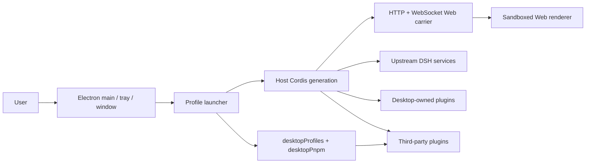

# DSH Desktop Architecture

## Overview

DSH Desktop is a thin Electron host. It starts the official DSH Host in Electron's main process; the Host exposes the ordinary Web UI over an HTTP/WebSocket Web carrier. The carrier listens on loopback by default and can be exposed to the LAN only after the user explicitly acknowledges the risk. Desktop does not create a second renderer IPC plugin system and does not expose raw Electron APIs to the page.

## Startup order

1. Electron acquires the single-instance lock and reads Desktop-owned profile/mode state.
2. The launcher prepares the active profile without modifying profiles merely to list them.
3. The launcher provides the native runtime, the generation's `desktopProfiles` bootstrap, and the bundled pnpm environment.
4. The Host Cordis root mounts Loader entries. Desktop services are registered before third-party entries can consume them.
5. `dsh-base`, `dsh-web-app`, and the selected profile's third-party bundles compose the Web carrier.
6. The Host binds loopback by default or all network interfaces when the confirmed setting requests it; Electron creates the BrowserWindow and loads the same-origin page through the loopback address.
7. The tray is created only after the Web surface loads, and the profile is committed as last-known-good.

Every profile or mode switch disposes the current generation before starting the next one. Service references, window objects, and subprocess handles must not be cached across generations.

## Host, Client, and native runtime

- **Upstream Host** owns agent, model, tool, session, settings, webServer, and subprocess capabilities.
- **Desktop Host** owns the window, tray, profiles, terminal, updates, and the two public Desktop services.
- **Web Client** contains the official Web UI and third-party browser contributions. It works over the shared Web carrier and does not call Electron directly.
- **Native runtime** adapts Electron BrowserWindow, the tray, filesystem/network operations, and installers. `desktopRuntime` is for Desktop-owned rows only.

Compatibility mode validates its environment and adds only an independent 36-pixel Desktop frame through the overlay slot; the official layout, root, sidebar, and conversation remain an unrelated content viewport below it. Extended mode disables the official root layout and installs its own Desktop layout/sidebar registration, which continues to host the official sidebar, conversation, and details occupants inside an inverted-L material frame. Enhanced mode keeps a separate root registration and its original compact internal-caption geometry. macOS and Windows apply capability-gated native materials without changing the ownership of upstream occupant slots.

Desktop-level confirmations, warnings, errors, and results do not enter the Web Client tree. `DesktopDialogWindow` creates a separate sandboxed modal `BrowserWindow`, applies the shared empty utility frame, parents it to the active generation window when possible, and accepts only one bounded local response. Recovery and Profile creation are separate Desktop-owned windows using the same title-free frame. Recovery itself is a shadcn page with reason-first presentation and four workflow tabs; destructive recovery actions delegate their confirmation back to `DesktopDialogWindow`.

### Native shell generation and platform adapters

`ElectronRuntime` coordinates the Host and native desktop environment without directly owning window and tray details. Each start creates one `ElectronShellGeneration` module that completely owns its `BrowserWindow`, `Tray`, related Electron listeners, navigation restrictions, external-link handling, and zoom shortcuts. A generation must be disposed through its idempotent `release()` interface; callers must not cache or destroy those resources separately across generations.

Platform differences live at the `ElectronPlatformStrategy` seam selected once during startup. The Windows, macOS, and Linux adapters declare directory-picking, shell-mode, and update-download capabilities and own their platform-specific menu, Dock icon, and native-material operations. New platform branches belong in the corresponding adapter; the generation and runtime retain only the lifecycle shared across platforms.

### Native file selection for plugins

The Legacy and Next product pages use `dshDesktop.filePicker.open` to choose files or a directory. A user action from the trusted top-level page reaches the main process through the preload, and the operating system dialog is attached to that product window. Each window accepts one pending plugin selection at a time. Existing plugin import flows consume the paths, cancellation returns an empty list, and failures return an error code.

Browser sessions use the existing Host path. Verify matching shell and plugin builds together. An older shell without the bridge presents an update message for the affected path selectors.

## Profile and service boundaries

The profile name and absolute directory come from `desktopProfiles.current`; they must not be inferred from argv, settings, or a URL. `list()` is read-only discovery. `select()` records a pending target and completes the switch through restart.

`desktopPnpm.run()` runs bundled pnpm directly. `runPlugin()` uses packaged DSH CLI semantics so profile initialization, relative sources, and bundle reconciliation remain authoritative. Both operations belong to the current generation and use the subprocess service for complete process-tree ownership.

The launcher-private `desktopRuntime`, `desktopPnpmBootstrap`, Electron executable, Node helpers, and ABI environment are not third-party APIs. OmniMux exposes `dsh-plugin-desktop/profile-service` and `dsh-plugin-desktop/pnpm`.

## Packaging and runtime closure

Release artifacts use Electron Builder and `app.asar`, while dependencies that must be physical (for example pnpm, node-pty, and Windows ACL/native files) live under `app.asar.unpacked`. The packaged-runtime gate checks both archive entries and physical runtime entries; profile fallback links must not target virtual ASAR paths that Node cannot resolve.

The outer workspace uses Yarn. The pinned `deepseek-harness/` submodule keeps its own pnpm workspace. The active desktop shell `dsh-desktop-next` pins DSH `0.2.2-rc.5` (tracked in `dsh-version.json` and the `next` channel of `upstream.json`), while the legacy shell `dsh-plugin-desktop` remains frozen on DSH `0.2.1-rc.3` (`stable` channel).

The physical runtime includes `lib`, `node_modules`, package metadata, and the product preset. CLI and Worker processes use this same tree. Unsigned directory builds disable signing and publishing; final artifact checks verify Electron fuses and execute the packaged CLI and diagnostic Worker.

### Dual-shell built-in Office skill boundary

`dsh-desktop-next` and `dsh-plugin-desktop` intentionally differ in whether they ship upstream Office skills and document preview binaries:

| Desktop shell | Pinned DSH baseline | Upstream Office skills (`@deepseek-ai/dsh-skill-office`, 7 skills: `office`, `office-docx`, `office-pptx`, `office-xlsx`, `office-export-pdf`, `office-render`, `office-recalculate`) | Rationale & source of truth |
|---|---|---|---|
| `app/dsh-desktop-next` (active shell) | `0.2.2-rc.5` | **Not shipped** (disabled by default) | Installer size tradeoff: Office preview pulls `@deepseek-ai/libreoffice-kit-*` (~305 MB across dual CPU architectures). [`cordis.patch.yml`](../dsh-desktop-next/cordis.patch.yml) explicitly disables `office-kit` and `skill-office`, paired with [`runtime-file-policy.ts`](../dsh-desktop-next/scripts/runtime-file-policy.ts) excluding `@deepseek-ai/dsh-skill-office`, `@deepseek-ai/dsh-office-kit`, `@deepseek-ai/dsh-tool-office`, and `@deepseek-ai/libreoffice-kit-*` from the release payload (pinned by `dsh-desktop-next/tests/payload-exclusions.spec.ts`). |
| `app/dsh-plugin-desktop` (frozen legacy shell) | `0.2.1-rc.3` | **Retained from upstream baseline** | Keeps the frozen `0.2.1-rc.3` upstream composition without excluding `@deepseek-ai/dsh-skill-office`. |

Product plugins must never duplicate those 7 upstream Office skill slugs (enforced by `plugins/scripts/verify-skill-hygiene.mjs`). On `dsh-desktop-next`, users who need `.docx` / `.xlsx` / `.pptx` processing can rely on local scripts/tools or install community/personal skills on demand via DSH Terminal.

## Stable updates and isolated recovery

OmniMux uses `ai.omnimux.desktop` and runs its standalone updater engine under `app/dsh-desktop-next/src/omnimux-updater/` against `https://dl.omnimux.ai/api/desktop/v2/<channel>.json` paired with its sibling `.sig` raw-byte Ed25519 signature envelope. The production verification key (`k1`) is embedded in `product-identity.ts`, so builds strictly enforce Ed25519 signatures by default and disable unsigned HTTP 404 downgrade fallback to legacy `api/desktop/version-<channel>.json`. Production builds default to the `stable` channel, and `updateChannel` is stored in `desktop-preferences-extra.json` so downgrades to older releases remain safe.

Update checks enforce `minSupportedVersion`, deterministic rollout bucketing (hashed from installation UUID), and OS minimums, then download immutable versioned installers under `releases/v<ver>/...` with parallel Range chunks, idle-timeout retries, and mandatory SHA-256 verification. Before handoff, preflight checks macOS App Translocation, install-directory writability, free disk space, and active Host tasks (`host/update-tasks.ts` locks admission and tears down the Host gracefully). In packaged production installs, bundled OmniMux product plugins are never shadowed by an equal-or-older Profile-local copy, while Dev builds, source runs, and `OMNIMUX_ALLOW_LOCAL_PLUGIN_OVERRIDE=1` preserve local development overrides.

Normal startup seeds the `omnimux` Profile. Dev uses `~/.omnimux-dev` and port `45120`; production uses `~/.omnimux` and port `44120`. Safe Mode selects disposable home and desktop-state directories and skips product seeding. Leaving Safe Mode restores normal Profile selection; the next normal launch removes the temporary environment.

## Maintainer reading

- [Desktop service contract](../dsh-plugin-desktop/docs/plugin-services.md)
- [Package README](../dsh-plugin-desktop/README.md)
