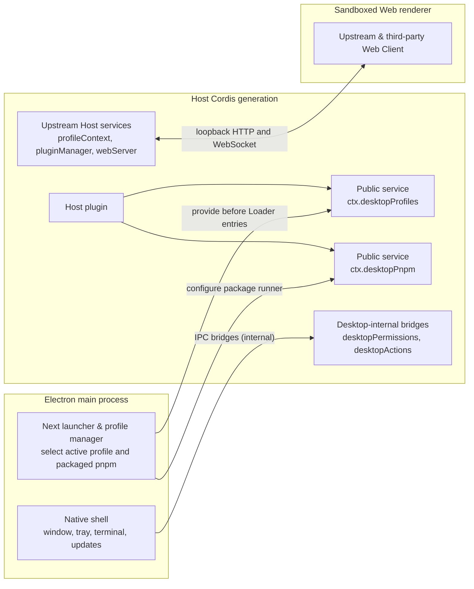

# DSH Desktop plugin services

English | [中文](plugin-services.zh.md)

This document is the supported Host integration contract for plugins running inside `dsh-desktop-next`. It covers the public Host Cordis services `desktopProfiles` and `desktopPnpm` provided by [`src/extensions.ts`](../src/extensions.ts). It does not grant third-party access to raw Electron APIs, preload bridges, or internal launcher state.

> **Single-shell note:** `dsh-desktop-next` does not publish legacy `dsh-plugin-desktop/*` TypeScript subpath exports, `desktopProfiles.list()`, `desktopProfiles.select()`, `desktopPnpm.installPlugin()`, or Client `desktopWindow` APIs (all retired alongside `dsh-plugin-desktop`). Import Cordis `Context` and declare structural interfaces locally.

## Layers and data flow



The Host resolves the active profile before Loader entries consume `desktopProfiles`. `desktopProfiles.current` remains fixed until that Host Cordis generation shuts down or restarts. Browser-side UI receives ordinary Web Client modules over the loopback carrier and cannot directly access Host services.

## Public Host Cordis services

Because `desktopProfiles` and `desktopPnpm` are registered dynamically on the Host Cordis context (`dsh-desktop-next` exposes no `profile-service` or `pnpm` package subpath exports), define structural TypeScript interfaces locally when consuming them:

```ts
export interface DesktopProfiles {
  readonly current: {
    readonly name: string
    readonly dir: string
  }
}

export interface DesktopPnpmOutcome {
  readonly exitCode: number | null
  readonly signal: NodeJS.Signals | null
}

export interface DesktopPnpmHandle {
  readonly stdout: NodeJS.ReadableStream
  readonly stderr: NodeJS.ReadableStream
  readonly done: Promise<DesktopPnpmOutcome>
  cancel(): void
}

export interface DesktopPnpm {
  run(argv: readonly string[], signal?: AbortSignal): DesktopPnpmHandle
  runPlugin(argv: readonly string[], invokingDir: string, signal?: AbortSignal): DesktopPnpmHandle
}
```

### `desktopProfiles`

- `current` is immutable for the lifetime of the Host generation (`{ name, dir }`).
- Do not infer the active profile name or directory from `process.argv`, `ctx.baseUrl`, settings, Loader rows, or `$DSH_HOME`; read `ctx.desktopProfiles.current`.
- Profile switching and creation happen through Next's native profile manager across a full process restart rather than in-place service mutations.

### `desktopPnpm`

[`createPackageRunner()`](../src/extensions.ts#L83-L147) backs `ctx.desktopPnpm` and serializes subprocess operations per Host generation:

| Method | Process and working directory | Supported purpose |
| --- | --- | --- |
| `run(argv, signal?)` | Runs the packaged pnpm entry directly with the active Profile directory (`current.dir`) as `cwd`. Appends `--config.minimumReleaseAge=0` once without persisting config changes. | Caller-owned pnpm operations (`add`, `remove`, `install`, `--dir <dir> run build`). |
| `runPlugin(argv, invokingDir, signal?)` | Runs packaged `plugin-cli.js <profile> ...` from an explicit absolute `invokingDir` with `DSH_HOME` scoped to the profile parent root. | Compatibility runner for bundled `dshmarket` plugin commands with upstream bundle reconciliation. |

Behavioral guarantees and caller responsibilities:

- Every call validates non-empty, NUL-free `argv`, plus an absolute NUL-free `invokingDir` for `runPlugin()`.
- At most one package operation may run per Host generation; calling `run()` or `runPlugin()` while an operation is active or after disposal throws synchronously.
- Both streams (`stdout` / `stderr`) are exposed as `Readable`; callers must drain them, manage deadlines with an `AbortSignal`, await `done`, and check both `exitCode` and `signal`.
- Calling `cancel()`, aborting `signal`, or disposing the runner signals the entire subprocess group (`SIGTERM` then `SIGKILL` after 2 seconds on POSIX, or `taskkill.exe /t /f` on Windows).
- `dsh-community-market` manages packages through the official upstream `pluginManager` service and does not depend on `desktopPnpm`.

## Internal capabilities not part of the contract

| Name | Boundary | Plugin-author status |
| --- | --- | --- |
| `desktopProfiles` | Generation-scoped Host service (`current: { name, dir }`). | Public; inject `'desktopProfiles'`. |
| `desktopPnpm` | Generation-scoped Host service (`run`, `runPlugin`). | Public; inject `'desktopPnpm'`. |
| `desktopPermissions` | IPC host permission bridge when spawned under Electron. | Desktop-internal. Do not inject or depend on its protocol. |
| `desktopActions` | Electron action bridge (`terminal`, `restart`) for Host adapters. | Desktop-internal. Not a third-party compatibility contract. |
| Electron `BrowserWindow`, preload bridges, `ELECTRON_RUN_AS_NODE`, state files | Launcher and shell runtime internals. | Private internals; may change without notice. |

## Injection patterns

### Desktop-only plugin: required injection

Declare both services in top-level `inject` so Cordis keeps the plugin pending until Desktop services are ready and cleans up effects on teardown:

```ts
import type { Context } from '@deepseek-ai/cordis'

interface DesktopContext extends Context {
  desktopProfiles: { readonly current: { readonly name: string; readonly dir: string } }
  desktopPnpm: {
    run(argv: readonly string[], signal?: AbortSignal): {
      readonly stdout: NodeJS.ReadableStream
      readonly stderr: NodeJS.ReadableStream
      readonly done: Promise<{ readonly exitCode: number | null; readonly signal: NodeJS.Signals | null }>
      cancel(): void
    }
  }
}

export const name = 'example-desktop-plugin-manager'
export const inject = ['desktopProfiles', 'desktopPnpm']

export function apply(ctx: DesktopContext): void {
  ctx.logger.info(`active Desktop profile: ${ctx.desktopProfiles.current.name}`)
  ctx.effect(() => {
    let active: ReturnType<DesktopContext['desktopPnpm']['run']> | undefined

    async function installPackage(target: string): Promise<void> {
      const signal = AbortSignal.timeout(5 * 60_000)
      const operation = ctx.desktopPnpm.run(['add', '--save-exact', `${target}@1.0.0`], signal)
      active = operation
      operation.stdout.setEncoding('utf8')
      operation.stderr.setEncoding('utf8')
      operation.stdout.resume()
      operation.stderr.resume()
      try {
        const outcome = await operation.done
        if (outcome.exitCode !== 0 || outcome.signal !== null) {
          throw new Error(`pnpm exited with code=${String(outcome.exitCode)} signal=${String(outcome.signal)}`)
        }
      } finally {
        if (active === operation) active = undefined
      }
    }

    void installPackage
    return async () => {
      active?.cancel()
      await active?.done.catch(() => {})
    }
  }, 'example: Desktop package operation')
}
```

### Cross-environment plugin: optional Desktop adapter

Do not put Desktop services in the top-level required `inject` list when the plugin must also run in `dsh web` or CLI sessions. Probe `ctx.get('desktopProfiles')` and mount a nested `ctx.inject(['desktopPnpm'], ...)` adapter only inside Desktop:

```ts
import type { Context } from '@deepseek-ai/cordis'

export const name = 'cross-environment-plugin-manager'
export const inject = ['webServer', 'loader']

declare function mountOrdinaryManager(ctx: Context, profile: string): () => void
declare function mountDesktopManager(ctx: Context, profile: string, profileDir: string): () => void

export function apply(ctx: Context, config: { profile?: string }): void {
  const profiles = ctx.get('desktopProfiles') as { current: { name: string; dir: string } } | undefined
  if (profiles === undefined) {
    ctx.effect(() => mountOrdinaryManager(ctx, config.profile ?? 'web'), 'example: ordinary DSH manager')
    return
  }

  ctx.inject(['desktopPnpm'], (desktopCtx) => {
    desktopCtx.effect(
      () => mountDesktopManager(desktopCtx, profiles.current.name, profiles.current.dir),
      'example: Desktop plugin manager',
    )
  })
}
```

Do not guess a fallback `web` profile when `desktopProfiles` is already present.

## Verification and tests

Package runner serialization, `--config.minimumReleaseAge=0` policy deduplication, and process-tree cleanup on disposal are tested in [`tests/extensions.spec.ts`](../tests/extensions.spec.ts). Run the Next workspace checks from `app/`:

```sh
corepack yarn workspace dsh-desktop-next test
corepack yarn workspace dsh-desktop-next verify:host
```

## Failure and teardown checklist

1. Start package mutations only from an explicit user or administrator action.
2. Treat `desktopProfiles.current` as valid only for the active Host generation.
3. Pass explicit argv arrays; never concatenate shell strings or invoke Windows `.cmd` shims.
4. Reconcile Profile bundles and validate domain policy in the caller after pnpm finishes.
5. Supply an `AbortSignal` deadline, drain both streams, and inspect both `exitCode` and `signal` from `done`.
6. Cancel active operations from the owning Cordis effect disposer and await `done` during teardown.

## Stability boundary

The supported Host surface in `dsh-desktop-next` consists of `ctx.desktopProfiles.current`, `ctx.desktopPnpm.run()`, and `ctx.desktopPnpm.runPlugin()`. Internal Host bridges (`desktopPermissions`, `desktopActions`), Electron windows, state-file formats, and preload bridges remain internal implementation details. Keep non-Desktop fallbacks explicit and headless-safe.
