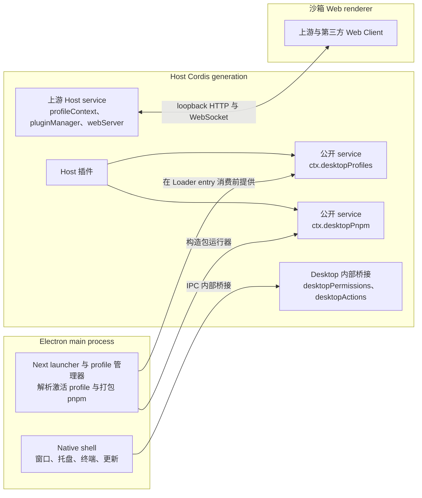

# DSH Desktop 插件 service

[English](plugin-services.md) | 中文

本文档面向插件作者，说明 `dsh-desktop-next` 通过 [`src/extensions.ts`](../src/extensions.ts) 提供的公开 Host Cordis service（`desktopProfiles` 与 `desktopPnpm`）。它不会授予第三方访问原始 Electron API、preload 桥接或 launcher 内部状态的能力。

> **单桌面壳说明：** `dsh-desktop-next` 不再导出历史 `dsh-plugin-desktop/*` 子路径类型，也不提供已随旧壳 `dsh-plugin-desktop` 退役移除的 `desktopProfiles.list()`、`desktopProfiles.select()`、`desktopPnpm.installPlugin()` 与 Client 侧 `desktopWindow`。在插件源码中导入 Cordis `Context` 并在本地声明结构化接口即可。

## 分层与数据流



Host 会在 Loader entry 消费前确定当前 profile；在当前 Host Cordis generation 关闭或重启前，`desktopProfiles.current` 保持不变。浏览器侧仅通过 loopback 接收普通 Web Client 模块，不能直接读取 Host service。

## 公开 Host Cordis service

由于 `desktopProfiles` 与 `desktopPnpm` 仅在 Host Cordis 上下文中按服务名动态注册（`dsh-desktop-next` 不导出 `profile-service` 或 `pnpm` 子路径），请在使用处声明结构化 TypeScript 接口：

```ts
export interface DesktopProfiles {
  readonly current: {
    readonly name: string
    readonly dir: string
  }
}

export interface DesktopPnpmOutcome {
  readonly exitCode: number | null
  readonly signal: NodeJS.Signals | null
}

export interface DesktopPnpmHandle {
  readonly stdout: NodeJS.ReadableStream
  readonly stderr: NodeJS.ReadableStream
  readonly done: Promise<DesktopPnpmOutcome>
  cancel(): void
}

export interface DesktopPnpm {
  run(argv: readonly string[], signal?: AbortSignal): DesktopPnpmHandle
  runPlugin(argv: readonly string[], invokingDir: string, signal?: AbortSignal): DesktopPnpmHandle
}
```

### `desktopProfiles`

- `current` 在当前 Host generation 生命周期内不可变（`{ name, dir }`）。
- 不要从 `process.argv`、`ctx.baseUrl`、settings、Loader row 或 `$DSH_HOME` 猜测 profile；请直接读取 `ctx.desktopProfiles.current`。
- 多 profile 的管理与切换由 Next 原生 Profile 管理器跨进程重启完成，不通过就地 service mutation 修改。

### `desktopPnpm`

[`createPackageRunner()`](../src/extensions.ts#L83-L147) 承载 `ctx.desktopPnpm`，并在单个 Host generation 内串行执行子进程命令：

| 方法 | 进程与工作目录 | 受支持用途 |
| --- | --- | --- |
| `run(argv, signal?)` | 直接调用打包的 pnpm 入口，以激活 Profile 目录（`current.dir`）为 `cwd`，在运行时追加一次 `--config.minimumReleaseAge=0` 而不写回用户配置。 | 由调用方管理语义的 pnpm 操作（`add`、`remove`、`install`、`--dir <dir> run build`）。 |
| `runPlugin(argv, invokingDir, signal?)` | 从调用方提供的绝对路径 `invokingDir` 执行打包的 `plugin-cli.js <profile> ...`，并自动限定 `DSH_HOME` 为 profile 上级根目录。 | 供内置 `dshmarket` 等兼容消费者执行带上游 bundle reconcile 的插件命令。 |

约束与调用方职责：

- 每次调用均校验非空且不含 NUL 的 `argv`，`runPlugin()` 额外校验 `invokingDir` 必须为绝对且不含 NUL 的路径。
- 每个 Host generation 同时只允许运行一个包操作；在已有操作活跃或运行器 dispose 后调用会同步抛错。
- 调用方负责持续排空 `stdout` / `stderr`、通过 `AbortSignal` 管理超时 deadline、等待 `done` 并同时检查 `exitCode` 与 `signal`。
- 调用 `cancel()`、触发 `AbortSignal` 或 dispose 运行器会向整个子进程树发送退出信号（POSIX 先 `SIGTERM` 并在 2 秒后 `SIGKILL`，Windows 使用 `taskkill.exe /t /f`）。
- `dsh-community-market` 通过上游官方 `pluginManager` 管理插件，不依赖 `desktopPnpm`。

## 内部能力与非兼容边界

| 名称 | 边界 | 面向插件作者的状态 |
| --- | --- | --- |
| `desktopProfiles` | 作用于 generation 的 Host service（`current: { name, dir }`）。 | 公开；通过 `inject: ['desktopProfiles']` 使用。 |
| `desktopPnpm` | 作用于 generation 的 Host service（`run`、`runPlugin`）。 | 公开；通过 `inject: ['desktopPnpm']` 使用。 |
| `desktopPermissions` | Electron 主进程内 Host 权限询问桥。 | Desktop 内部实现，请勿依赖或拦截。 |
| `desktopActions` | 供原生适配触发 `terminal` / `restart` 的桥接能力。 | Desktop 内部实现，非第三方兼容 contract。 |
| Electron `BrowserWindow`、preload 桥、`ELECTRON_RUN_AS_NODE`、状态文件格式 | Launcher 与原生壳内部细节。 | 私有实现，随时可能调整。 |

## Injection 模式

### 仅支持 Desktop 的插件：required injection

只在 Desktop 环境下启用的插件可直接把两项服务放入顶层 `inject`：

```ts
import type { Context } from '@deepseek-ai/cordis'

interface DesktopContext extends Context {
  desktopProfiles: { readonly current: { readonly name: string; readonly dir: string } }
  desktopPnpm: {
    run(argv: readonly string[], signal?: AbortSignal): {
      readonly stdout: NodeJS.ReadableStream
      readonly stderr: NodeJS.ReadableStream
      readonly done: Promise<{ readonly exitCode: number | null; readonly signal: NodeJS.Signals | null }>
      cancel(): void
    }
  }
}

export const name = 'example-desktop-plugin-manager'
export const inject = ['desktopProfiles', 'desktopPnpm']

export function apply(ctx: DesktopContext): void {
  ctx.logger.info(`active Desktop profile: ${ctx.desktopProfiles.current.name}`)
  ctx.effect(() => {
    let active: ReturnType<DesktopContext['desktopPnpm']['run']> | undefined

    async function installPackage(target: string): Promise<void> {
      const signal = AbortSignal.timeout(5 * 60_000)
      const operation = ctx.desktopPnpm.run(['add', '--save-exact', `${target}@1.0.0`], signal)
      active = operation
      operation.stdout.setEncoding('utf8')
      operation.stderr.setEncoding('utf8')
      operation.stdout.resume()
      operation.stderr.resume()
      try {
        const outcome = await operation.done
        if (outcome.exitCode !== 0 || outcome.signal !== null) {
          throw new Error(`pnpm exited with code=${String(outcome.exitCode)} signal=${String(outcome.signal)}`)
        }
      } finally {
        if (active === operation) active = undefined
      }
    }

    void installPackage
    return async () => {
      active?.cancel()
      await active?.done.catch(() => {})
    }
  }, 'example: Desktop package operation')
}
```

### 跨环境插件：可选 Desktop adapter

如果同一个包也必须在普通 `dsh web` 或命令行会话中运行，不要将 Desktop 服务放进顶层 required `inject`；请先探测 `ctx.get('desktopProfiles')`，仅在 Desktop 内嵌套 `ctx.inject(['desktopPnpm'], ...)`：

```ts
import type { Context } from '@deepseek-ai/cordis'

export const name = 'cross-environment-plugin-manager'
export const inject = ['webServer', 'loader']

declare function mountOrdinaryManager(ctx: Context, profile: string): () => void
declare function mountDesktopManager(ctx: Context, profile: string, profileDir: string): () => void

export function apply(ctx: Context, config: { profile?: string }): void {
  const profiles = ctx.get('desktopProfiles') as { current: { name: string; dir: string } } | undefined
  if (profiles === undefined) {
    ctx.effect(() => mountOrdinaryManager(ctx, config.profile ?? 'web'), 'example: ordinary DSH manager')
    return
  }

  ctx.inject(['desktopPnpm'], (desktopCtx) => {
    desktopCtx.effect(
      () => mountDesktopManager(desktopCtx, profiles.current.name, profiles.current.dir),
      'example: Desktop plugin manager',
    )
  })
}
```

检测到 `desktopProfiles` 存在后，不要回退到猜测的 `web` profile。

## 验证与测试

包运行器的并发互斥、`--config.minimumReleaseAge=0` 策略去重与 teardown 进程树回收逻辑由 [`tests/extensions.spec.ts`](../tests/extensions.spec.ts) 验证。可在 `app/` 目录运行：

```sh
corepack yarn workspace dsh-desktop-next test
corepack yarn workspace dsh-desktop-next verify:host
```

## 失败处理与清理清单

1. 仅在明确的用户或管理员触发动作中启动包操作。
2. 将 `desktopProfiles.current` 视作当前 Host generation 内的有效快照，勿跨重启缓存。
3. 始终传 argv 数组；不要拼接 shell 命令，也不要依赖 Windows `.cmd` shim。
4. pnpm 完成后由调用方自行完成 Profile bundle reconcile 与业务策略校验。
5. 传入超时 `AbortSignal`，排空输出流并同时检查 `done` 的 `exitCode` 与 `signal`。
6. 在 Cordis effect disposer 中取消在途操作并等待 `done` 落定。

## 稳定性边界

`dsh-desktop-next` 对第三方插件支持的 Host contract 为 `ctx.desktopProfiles.current`、`ctx.desktopPnpm.run()` 与 `ctx.desktopPnpm.runPlugin()`；内部桥接（`desktopPermissions`、`desktopActions`）、Electron 窗口对象、状态文件格式与 preload 均属内部实现细节。跨环境插件的非 Desktop fallback 须保持显式、生命周期内且 headless-safe。
