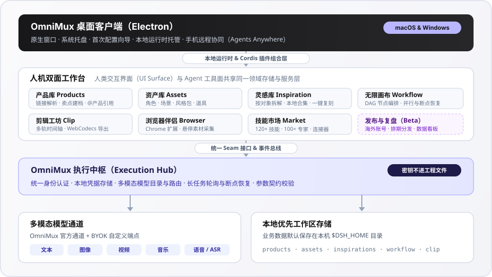

<p align="center">
  <picture>
    <source media="(prefers-color-scheme: dark)" srcset="readme/omnimux-wordmark-dark.svg">
    <source media="(prefers-color-scheme: light)" srcset="readme/omnimux-wordmark-light.svg">
    
  </picture>
</p>

<p align="center">
  <strong>属于你的本地 AI 内容电商团队</strong><br>
  <sub>面向内容电商与品牌增长的一站式桌面 Agent 工作台：让商品卖点与视觉资产贯穿每一次出片</sub>
</p>

<p align="center">
  <a href="https://omnimux.ai"></a>
  <a href="https://dl.omnimux.ai"></a>
  <a href="https://github.com/omnimux-ai/omnimux-client/releases/latest"></a>
  <a href="https://github.com/omnimux-ai/omnimux-client"></a>
  <a href="../LICENSE"></a>
</p>

<p align="center">
  <a href="https://discord.gg/omnimux"></a>
  <a href="https://x.com/omnimux_ai"></a>
  <a href="#community"></a>
  <a href="https://github.com/omnimux-ai/omnimux-client/discussions"></a>
</p>

<p align="center">
  <a href="#quick-start">下载安装</a> ·
  <a href="#use-cases">应用场景</a> ·
  <a href="#capabilities">核心能力</a> ·
  <a href="#models">模型生态</a> ·
  <a href="#architecture">架构与开发</a> ·
  <a href="#status">交付状态</a> ·
  <a href="#community">社区</a>
</p>

<p align="center">
  <a href="../README.md">English</a> · <strong>简体中文</strong>
</p>

---

# OmniMux

**OmniMux** 是一套开源、本地优先的 **AI 内容电商桌面工作台**，将商品档案、视觉资产、爆款拆解、多模态无限画布与多轨时间轴视频剪辑整合进同一个桌面应用，让创作者与 Agent 在同一工作区实时协同。

- 🛍️ **商品卖点贯穿每一次出片**：在产品库粘贴商品落地页自动提取卖点、受众与媒体路径；在创作资产库管理可复用的角色、场景、风格包与道具。对话和画布随时通过 `@产品` 调用，避免反复重述需求。
- 🔍 **从爆款拆解到结构化复刻**：通过浏览器伴侣悬停采集网页与社媒素材，在灵感库保留原文与独立译文，按整帖、正文或单条视频拆解钩子与节奏，一键附入新会话进入创作。
- 🧩 **无限画布 + 多轨时间轴，人机双向协同**：在可视化节点画布上串联生图、生视频、对口型、配乐与配音，直接打开内置多轨剪辑工坊精剪并本地导出 MP4。手动操作与 Agent 工具调用共享同一份工程状态，随时接力修改。
- 🔑 **开箱即用，数据留在本地**：提供 macOS 与 Windows 原生安装包，无需配置 Node.js 或命令行环境；执行中枢同时支持官方模型通道与自带密钥（BYOK），凭据与工程数据默认保存在本机。

---

<a id="quick-start"></a>

## ⚡ 下载与快速上手

### 1. 下载桌面客户端（推荐）

原生安装包已内置运行环境与核心内容电商插件套件，下载安装即可启动，无需手动安装 Node.js 或配置命令行。

| 平台 | 官方下载 | 安装说明 |
| --- | --- | --- |
| **macOS（Apple Silicon / M 系列）** | [下载 `OmniMux-arm64.dmg`](https://dl.omnimux.ai/releases/latest/OmniMux-arm64.dmg) | 打开 DMG，拖入 `Applications` |
| **macOS（Intel）** | [下载 `OmniMux-x64.dmg`](https://dl.omnimux.ai/releases/latest/OmniMux-x64.dmg) | 打开 DMG，拖入 `Applications` |
| **Windows（x64）** | [下载 `OmniMux-Setup.exe`](https://dl.omnimux.ai/releases/latest/OmniMux-Setup.exe) | 运行安装程序并按提示完成安装 |

> 历史版本与安装包同步发布在 [GitHub Releases](https://github.com/omnimux-ai/omnimux-client/releases)，官网访问 [omnimux.ai](https://omnimux.ai)。

### 2. 三分钟跑通你的第一条商品视频

安装完成后，登录 OmniMux 账号或在设置中配置自定义模型端点，然后试试下面的流程：

1. **导入商品**：打开左侧 **产品库 → + 添加产品**，粘贴任意商品落地页链接自动解析卖点与商品素材并保存。
2. **启动创作**：新建会话，在输入框里用 `@产品` 选中刚才的商品，发送一句自然语言指令：

```text
结合 @产品/你的商品名称 的核心卖点，帮我策划一条 15 秒竖屏带货短视频：
1. 先输出前 3 秒钩子和分镜脚本；
2. 在工作流画布中搭建生图与分镜视频节点；
3. 生成后导入视频剪辑工坊，让我可以继续微调字幕和节奏并导出 MP4。
```

3. **人机接力精修**：在画布上直接更换参考图或重跑单个节点；进入剪辑工坊后，既可以手动拖轨剪辑，也能点击顶栏 **AI 剪辑**，将当前工程、播放头与选段上下文同步到对话中继续微调。

---

<a id="use-cases"></a>

## 🎞️ 典型应用场景

<table width="100%">
  <tr>
    <td width="50%" valign="top">
      <strong>🛍️ 商品建档与卖点直通出片</strong><br>
      粘贴商品页链接自动解析名称、核心卖点、受众与价格字段，原图以只读路径关联，通过 <code>@产品</code> 将准确的商品事实直接带入脚本和分镜提示词。
    </td>
    <td width="50%" valign="top">
      <strong>🔎 社媒爆款采集与结构拆解</strong><br>
      使用浏览器伴侣悬停采集视频与图片素材，在灵感库整理为本地合集，针对整帖、正文或单条视频拆解钩子与表达结构，一键带入新会话创作。
    </td>
  </tr>
  <tr>
    <td width="50%" valign="top">
      <strong>🕸️ 多模态工作流无限画布</strong><br>
      在 DAG 节点画布上串联提示词、角色参考图、首尾帧视频、对口型与背景音乐生成，支持类型校验、并行节流、子图运行与断点恢复。
    </td>
    <td width="50%" valign="top">
      <strong>🎬 多轨精剪与 AI 实时联动</strong><br>
      在三栏多轨时间轴完成裁切、音轨编排与 WebCodecs/WebGPU 本地导出；从画布合成节点进入剪辑工坊后，新导出成片自动回写至画布下游节点。
    </td>
  </tr>
</table>

---

<a id="capabilities"></a>

## ✨ 核心工作台能力

### 1. 产品库与创作资产库

把商品事实和可复用视觉资产结构化沉淀在本地，避免每次创作从零拼凑：

- **产品库（`omnimux-products`）**：面向可售商品设计，支持落地页链接解析、双端首屏预览、卖点/受众/SKU 字段管理；媒体仅保存本机路径引用，永不移动或误删原始素材。
- **创作资产库（`omnimux-assets`）**：按 **角色 / 场景 / 风格包 / 道具 / 知识包 / 自定义** 六类管理本地复用对象，支持多视角素材归档，并内置云端素材目录浏览。

### 2. 灵感库与浏览器伴侣

把日常刷到的好内容沉淀成可调用的创作素材：

- **灵感库（`omnimux-inspiration`）**：保留帖子完整原文、独立译文与多图/视频附件；支持按 **整帖、正文或单条媒体** 分对象拆解内容与表达，支持拖拽归组为本地合集，并将选定片段与思路作为附件挂入会话。
- **浏览器伴侣（`omnimux-browser`）**：配套 Chrome Manifest V3 扩展，通过本机鉴权 WebSocket 桥连接桌面端，提供网页悬停媒体采集胶囊、结构化页面读取与同步桌面模型目录的侧边栏对话。

### 3. 工作流无限画布与视频剪辑工坊

所有核心工作台能力均采用**双面交付**：可视化操作界面与 Agent 工具面共享同一套底层存储、参数校验与状态流转。

| 模块 | 你可以直接做什么 | Agent 如何协同 |
| --- | --- | --- |
| **无限画布（`omnimux-workflow`）** | 拖拽物料与多模态生成节点、管理有序参考图卡槽、按全图 / 子图 / 单节点运行、撤销重做与断点恢复 | 读取画布快照、增删改节点与连线、切换有效模型线路、触发并追踪执行任务 |
| **剪辑工坊（`omnimux-clip`）** | 三栏多轨非线性时间轴、实时合成帧查看、基于 WebCodecs/WebGPU 本地导出 MP4 | 点击顶栏 **AI 剪辑** 同步当前工程、版本、播放头与选段上下文，支持整批剪辑、一步撤销与显式导出确认 |

> 打开画布中的 `video_composition` 节点即可在当前画布内直连剪辑工坊；导出成片后，新版本 MP4 会自动回写到工作流下游节点。

### 4. 插件与技能市场 & 原生桌面体验

- **技能与专家市场（`omnimux-market`）**：内置 **120+ 内容电商与营销技能**（覆盖 UGC 口播、视频广告、静态广告图、产品展示、故事脚本等）与 **100+ 专家角色**，支持插件、技能、专家与 MCP 连接器统一检索安装。
- **原生桌面与移动协同**：自动托管本地运行时、首次启动向导与系统托盘控制；内置 **Agents Anywhere** 手机远程连接，可在 iOS / Android 随时查看出片进度并继续下达指令。

---

<a id="models"></a>

## 🎛️ 多模态模型与灵活接入

**OmniMux 执行中枢（`omnimux`）** 统一承接身份认证、本地凭据管理、模型目录分发以及长耗时媒体任务的轮询与断点恢复：

- **OmniMux 官方通道**：登录账号即可使用统一多模态模型目录，无需逐一对接多家接口；
- **自带密钥（BYOK）**：支持在设置中配置自定义兼容端点与 API Key，密钥仅存放在本机凭据存储，不进入工程或画布文件。

| 模态 | 支持的主流模型家族 | 典型用途 |
| --- | --- | --- |
| **💬 文本与多模态理解** | DeepSeek V4、Claude、GPT-5、Gemini、Grok、Kimi、GLM | 卖点提炼、爆款拆解、脚本策划、Agent 工具编排 |
| **🖼️ 图像生成与垫图** | GPT Image 2.5、Nano Banana 2 / Pro、Seedream 5.0 Pro、Midjourney、Grok Imagine | 商品主图、人物设定图、多图参考分镜帧 |
| **🎬 视频生成** | Seedance 2.0 / 2.5、Kling V2.6 / V3 / O3、Wan 3.0、MiniMax H3、Grok Imagine Video | 文生视频、首帧/首尾帧、全能参考、视频延长、对口型 |
| **🎵 音乐与语音** | Suno Music、Gemini TTS、Seed Audio、Index TTS2 声音克隆、Whisper / Doubao ASR | 定制背景音乐、多音色口播配音、语音转字幕 |

> 实际可用模型、画幅、时长与参考素材上限随当前通道目录动态生效，界面与画布会在提交前自动完成参数契约校验。

---

<a id="architecture"></a>

## 🏗️ 架构与本地开发

### 系统架构

OmniMux 将原生桌面壳（`app/`）与产品插件工作区（`plugins/`）放在同一仓库中协同开发与发布。所有业务插件不直接持有外部供应商密钥或发起外部模型请求，统一经由执行中枢完成路由与状态管理。

<p align="center">
  
</p>

<details>
<summary>展开查看文本版架构图</summary>

```text
+-----------------------------------------------------------------------+
|                       OmniMux 桌面客户端（Electron）                   |
|   原生窗口 · 系统托盘 · 首次配置向导 · 本地运行时托管 · 手机远程协同    |
+-----------------------------------+-----------------------------------+
                                    |
                    本地运行时 & Cordis 插件组合层
                                    |
+-----------------------------------+-----------------------------------+
|               人机双面工作台（UI Surface + Agent Tools）               |
|  产品库 · 资产库 · 灵感库 · 无限画布 · 剪辑工坊 · 浏览器伴侣 · 技能市场  |
+-----------------------------------+-----------------------------------+
                                    |
                        统一 Seam 接口 & 事件总线
                                    |
+-----------------------------------+-----------------------------------+
|                   OmniMux 执行中枢（Execution Hub）                    |
|    身份认证 · 本地凭据存储 · 模型目录与路由 · 任务恢复 · 参数契约校验   |
+------------------+---------------------------------+------------------+
                   |                                 |
                   v                                 v
      官方通道 / BYOK 自定义端点            本地优先工作区存储（$DSH_HOME）
   (文本 · 图像 · 视频 · 音乐 · 语音)     (products · assets · workflow · clip)
```

</details>

### 仓库目录

```text
omnimux-client/
├── app/                     # Electron 桌面端（Yarn 4 工作区，含打包、签名与原生集成）
│   ├── dsh-desktop-next/    # OmniMux 原生桌面产品壳
│   ├── dsh-plugin-desktop/  # 桌面能力插件（窗口、托盘、配置与更新）
│   ├── config/              # 插件分级清单（plugin-tiers.json）
│   └── docs/                # 用户指南、FAQ 与桌面架构文档
├── plugins/                 # 产品插件工作区（仓库根 pnpm workspace）
│   ├── packages/            # 共享 UI 组件库（dsh-ui-kit）与公共包
│   ├── plugins/             # 执行中枢与 12 个领域插件
│   └── docs/contracts/      # Agent 工具清单、画布生成与剪辑实时控制契约
├── docs/                    # 仓库级文档与子系统索引
└── scripts/                 # 工作区一致性校验与构建脚本
```

### 从源码构建

环境要求：**Node.js `^22.19 || >=24`**、**Corepack**（自动管理 pnpm 与 Yarn 4）。

```bash
# 1. 克隆仓库并初始化子模块
git clone https://github.com/omnimux-ai/omnimux-client.git
cd omnimux-client
git submodule update --init --recursive

# 2. 安装依赖并构建全部产品插件（仓库根目录）
corepack enable
corepack pnpm install --frozen-lockfile
corepack pnpm --dir plugins run build:all

# 3. 校验工作区元数据
node scripts/workspace-check.mjs --check

# 4. 启动桌面端开发模式（或打包安装包）
cd app
corepack yarn install --immutable
corepack yarn dev
# 如需构建 macOS 安装包：
# corepack yarn workspace dsh-desktop-next dist:mac
```

### 文档导航

| 面向人群 | 文档入口 |
| --- | --- |
| **普通用户** | [用户指南](../app/docs/user-guide.md) · [常见问题](../app/docs/faq.md) · [隐私政策](../app/PRIVACY.zh.md) |
| **桌面与插件开发者** | [桌面子树说明](../app/README.md) · [插件子树说明](../plugins/README.md) · [桌面架构说明](../app/docs/architecture.md) · [插件开发指南](../app/docs/plugin-development.md) |
| **契约与子系统索引** | [Agent 工具契约清单](../plugins/docs/contracts/plugin-agent-tools-inventory.md) · [画布生成契约](../plugins/docs/contracts/canvas-generation.md) · [剪辑实时控制契约](../plugins/docs/contracts/clip-live-control.md) · [子系统索引](subsystems.md) |

---

<a id="status"></a>

## 🧭 当前交付状态与路线图

各模块的当前发布档位以 [`app/config/plugin-tiers.json`](../app/config/plugin-tiers.json) 为准：

| 领域 | 当前状态 | 说明 |
| --- | --- | --- |
| **原生桌面客户端** | `已发布` | macOS（arm64 / x64）与 Windows（x64）安装包、首次配置向导、自动更新与手机远程协同 |
| **执行中枢与模型路由** | `Preview` | 账号登录、官方通道与 BYOK 配置、多模态统一执行与长任务恢复 |
| **产品库与创作资产库** | `Preview` | 商品链接解析建档、`@产品` 引用、六类本地创作资产与云端素材目录 |
| **灵感库与浏览器伴侣** | `Preview` | 社媒导入、原文与译文保留、按对象拆解、本地合集与 Chrome 悬停采集 |
| **无限画布与剪辑工坊** | `Preview` | DAG 节点编排、子图/断点执行、多轨时间轴剪辑、AI 剪辑联动与 MP4 本地导出 |
| **插件与技能市场** | `Preview` | 内置 120+ 技能、100+ 专家角色、插件与 MCP 连接器管理 |
| **账号、发布与数据复盘** | `Beta` | `omnimux-accounts`、`omnimux-publish`、`omnimux-analytics` 与 `omnimux-video` 持续演进，面向海外平台排期与复盘 |
| **后续规划方向** | `规划中` | 团队资产与知识协同、更丰富的电商连接器以及版本关联的效果复盘闭环 |

> **边界说明**：OmniMux 当前不提供国内平台（抖音/小红书/视频号/快手/B站）自动分发，也不对流量曝光、内容转化或账号状态作保证承诺。

---

<a id="community"></a>

## 💬 社区交流与参与贡献

欢迎加入社区交流内容电商出片工作流、探讨插件与技能开发，或提交问题反馈：

<table>
  <thead>
    <tr>
      <th align="center" width="50%">微信 / 企业微信交流群</th>
      <th align="center" width="50%">全球社区与开发者频道</th>
    </tr>
  </thead>
  <tbody>
    <tr>
      <td align="center" valign="middle">
        <br>
        <sub>微信或企业微信扫码加入 <strong>OmniMux 交流群</strong></sub>
      </td>
      <td align="center" valign="middle">
        <p><a href="https://discord.gg/omnimux"></a></p>
        <p><a href="https://x.com/omnimux_ai"></a></p>
        <p><a href="https://github.com/omnimux-ai/omnimux-client/discussions"></a></p>
        <sub>欢迎提交 <a href="https://github.com/omnimux-ai/omnimux-client/issues">Issue</a>、参与功能讨论或共建插件与技能</sub>
      </td>
    </tr>
  </tbody>
</table>

### 参与共建

| 贡献方向 | 入口 |
| --- | --- |
| **桌面端与原生集成** | [`app/README.md`](../app/README.md) · [桌面架构说明](../app/docs/architecture.md) |
| **领域插件、无限画布与剪辑工坊** | [`plugins/README.md`](../plugins/README.md) · [Agent 工具契约清单](../plugins/docs/contracts/plugin-agent-tools-inventory.md) |
| **电商/营销技能与专家预设** | [`plugins/plugins/omnimux-market/README.md`](../plugins/plugins/omnimux-market/README.md) |
| **贡献规范与安全通报** | [贡献指南](../CONTRIBUTING.md) · [行为准则](../CODE_OF_CONDUCT.md) · [安全策略](../SECURITY.md) |

---

## 📄 开源许可与商业授权

OmniMux 自研代码采用 **[AGPL-3.0](../LICENSE)** 许可（附 [NOTICE](../NOTICE) 中的第 7 条署名条款），同时提供**商业授权**：

| 使用方式 | AGPL-3.0（免费） | 商业授权 |
| :--- | :---: | :---: |
| 个人、团队或企业免费使用、修改、本地部署（含商业用途） | ✅ | ✅ |
| 修改后对外提供服务或分发，并公开对应修改源码 | ✅ | ✅ |
| 修改后对外提供服务或分发，且不公开修改源码 | ❌ | ✅ |
| 移除 `Powered by OmniMux` 署名或白标化定制发布 | ❌ | ✅ |

- 商业授权咨询：`hello@omnimux.ai`。
- 本仓库包含的第三方开源组件保留其原始许可证与版权声明，详见 [NOTICE](../NOTICE)、[`app/LICENSE`](../app/LICENSE) 与 [`plugins/ACKNOWLEDGEMENTS.md`](../plugins/ACKNOWLEDGEMENTS.md)。
- 配套服务端开源仓库：[`omnimux-ai/omnimux-gateway`](https://github.com/omnimux-ai/omnimux-gateway)。

---

<p align="center">
  <a href="https://github.com/omnimux-ai/omnimux-client"><strong>在 GitHub 上给 OmniMux 点个 Star</strong></a> ·
  <a href="https://www.star-history.com/#omnimux-ai/omnimux-client&Date">查看 Star 趋势</a><br>
  <sub>Copyright © 2026 OmniMux Project and Contributors.</sub>
</p>
