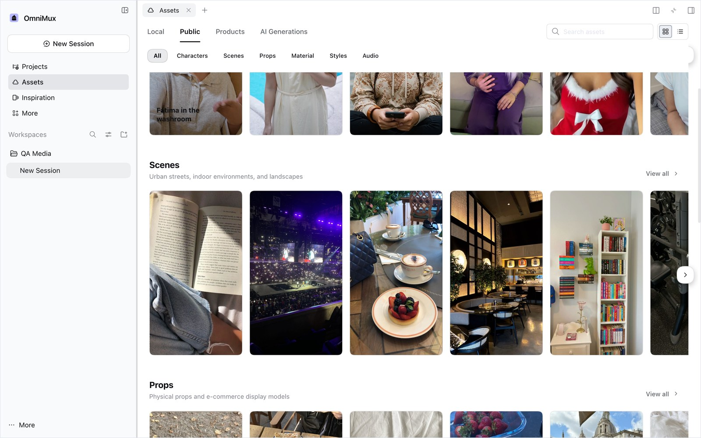
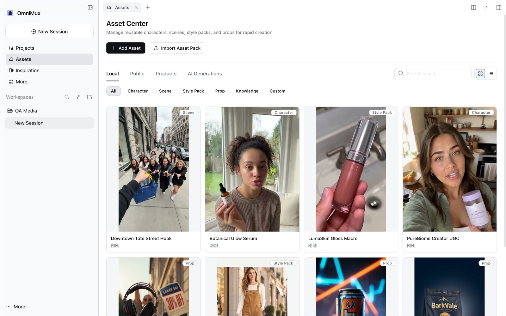
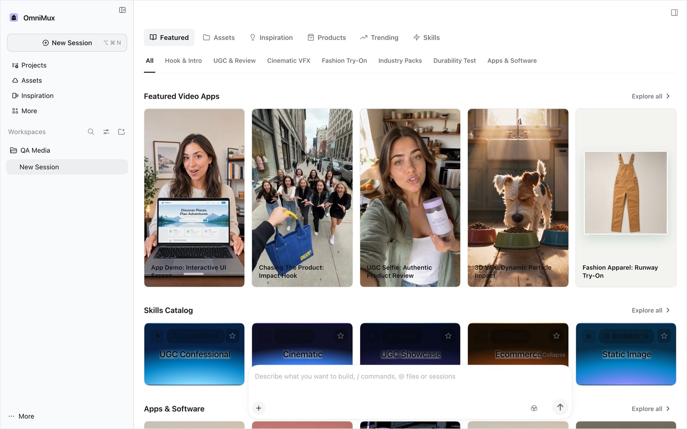

<p align="center">
  <picture>
    <source media="(prefers-color-scheme: dark)" srcset="readme/omnimux-wordmark-dark.svg">
    <source media="(prefers-color-scheme: light)" srcset="readme/omnimux-wordmark-light.svg">
    
  </picture>
</p>

<p align="center">
  <strong>属于你的开源本地 AI 内容电商视频工作台</strong><br>
  <sub>粘贴商品链接与参考视频，在一套桌面端完成拆解、资产管理、无限画布生成与多轨剪辑 — 人机协同，数据留在本地。</sub>
</p>

<p align="center">
  <a href="https://omnimux.ai"></a>
  <a href="#quick-start"></a>
  <a href="https://github.com/omnimux-ai/omnimux-client/actions/workflows/ci.yml"></a>
  <a href="https://github.com/omnimux-ai/omnimux-client/releases/latest"></a>
  <a href="https://github.com/omnimux-ai/omnimux-client/commits/main"></a>
  <a href="../LICENSE"></a>
</p>

<p align="center">
  <a href="https://discord.gg/omnimux"></a>
  <a href="https://x.com/omnimux_ai"></a>
  <a href="#community"></a>
  <a href="https://github.com/omnimux-ai/omnimux-client/discussions"></a>
</p>

<p align="center">
  <a href="#quick-start">快速上手</a> ·
  <a href="#showcase">带货案例</a> ·
  <a href="#cloud-assets">云端资产</a> ·
  <a href="#capabilities">界面与能力</a> ·
  <a href="#ecosystem">技能与生态</a> ·
  <a href="#models">模型路由</a> ·
  <a href="#architecture">架构与开发</a> ·
  <a href="#status">交付状态</a> ·
  <a href="#community">社区</a>
</p>

<p align="center">
  <a href="../README.md">English</a> · <strong>简体中文</strong>
</p>

<p align="center">
  
</p>
<p align="center">
  <sub>OmniMux 桌面工作台：将 Agent 对话、热门带货快捷入口与探索模板集成于本地客户端。</sub>
</p>

---

**OmniMux** 面向内容电商、跨境带货与品牌增长团队，解决 AI 出片中“提示词反复重写、人物与商品走样、云端工具割裂”的痛点。它将**产品库、内置 6,380+ 云端与本地创作资产库、灵感拆解、多模态无限画布与多轨时间轴剪辑工坊**整合进同一个基于 [DeepSeek Harness](https://github.com/deepseek-ai/deepseek-harness) 构建的本地桌面应用，让创作者与 AI Agent 在同一份实时工程中协同作业。

- 🛍️ **不再每次重述商品卖点** — 粘贴商品落地页自动解析卖点与本地媒体路径，沉淀可复用角色/场景/风格包，对话与画布随时 `@产品` 直通出片。
- ☁️ **内置 6,380+ 云端商业资产，开箱即用** — 应用内直连 350+ 多维筛选数字人、3,390+ 实景素材、940 款电商道具、700+ 前三秒爆款钩子、150+ 视觉风格包与 610+ 配音/背景音，支持实时试听预览、一键保存到本地资产库或直接附入对话与画布。
- 🔍 **把参考视频变成结构化脚本** — 用 Chrome 浏览器伴侣悬停采集素材，在灵感库保留原文与译文，按整帖或单条视频拆解钩子并一键送入新会话。
- 🧩 **无限画布与多轨时间轴，人机双向协同** — 在 DAG 画布串联生图、生视频、对口型、配音与配乐节点，进入内置多轨剪辑工坊精剪并本地导出 MP4。
- 🔑 **零命令行开箱即用，本地优先 + BYOK** — 提供 macOS 与 Windows 原生安装包，内置运行环境与核心插件；同时支持官方统一通道与自带 API Key（BYOK）。

---

<a id="quick-start"></a>

## ⚡ 下载与快速上手

### 1. 下载桌面客户端（推荐，无需 Node.js 或命令行）

| 平台 | 官方直链下载 | 安装说明 |
| --- | --- | --- |
| **macOS（Apple Silicon / M 系列）** | [下载 `OmniMux-arm64.dmg`](https://dl.omnimux.ai/releases/latest/OmniMux-arm64.dmg) | 打开 DMG，拖入 `Applications` |
| **macOS（Intel）** | [下载 `OmniMux-x64.dmg`](https://dl.omnimux.ai/releases/latest/OmniMux-x64.dmg) | 打开 DMG，拖入 `Applications` |
| **Windows（x64）** | [下载 `OmniMux-Setup.exe`](https://dl.omnimux.ai/releases/latest/OmniMux-Setup.exe) | 运行安装程序并按向导完成安装 |

> 历史版本与校验信息同步发布于 [GitHub Releases](https://github.com/omnimux-ai/omnimux-client/releases)，最新动态见 [omnimux.ai](https://omnimux.ai)。

### 2. 3 分钟跑通第一条商品带货视频

安装启动后，登录 OmniMux 账号或在**设置**中配置自定义模型端点，即可按下面 3 步体验：

1. **导入商品**：打开左侧 **产品库 → + 新建产品**，粘贴任意商品页链接自动提取卖点与商品图路径并保存。
2. **用 `@产品` 启动创作**：新建对话，输入你的创作简报：

```text
结合 @产品/你的商品名称 的核心卖点，帮我策划一条 15 秒竖屏带货短视频：
1. 先输出前 3 秒钩子和分镜脚本；
2. 在工作流画布中搭建生图与分镜视频节点；
3. 生成后导入视频剪辑工坊，让我可以继续微调字幕和节奏并导出 MP4。
```

3. **人机接力精修**：在画布直接替换参考图或重跑单个节点；进入剪辑工坊后，既可手动拖轨，也可点击顶栏 **AI 剪辑**，将当前工程、播放头与选段上下文同步到对话继续微调。

> ⭐ **觉得对你的工作流有帮助？** 欢迎 [在 GitHub 上给 OmniMux 点个 Star](https://github.com/omnimux-ai/omnimux-client) — 2 秒即可关注版本更新，也能让更多创作者与开发者发现本项目。

---

<a id="showcase"></a>

## 🎬 带货视频案例展示

围绕商品档案、可复用视觉资产与多模态工作流模板，覆盖内容电商常见竖屏带货成片形态：

### 商品广告大片与视觉钩子

<table width="100%">
  <tr>
    <td width="33%" align="center" valign="top">
      <picture>
        <source media="(prefers-reduced-motion: reduce)" srcset="readme/showcase/pet-food-commercial.jpg">
        
      </picture><br>
      <strong>3D 视效商品大片</strong><br>
      <sub>动态倒粮开场自然衔接暖光棚拍包装特写，商品主体与袋身信息保持一致</sub>
    </td>
    <td width="33%" align="center" valign="top">
      <picture>
        <source media="(prefers-reduced-motion: reduce)" srcset="readme/showcase/apparel-tryon.jpg">
        
      </picture><br>
      <strong>服饰平铺转动态试穿</strong><br>
      <sub>单张商品平铺图一键延展为多角度模特上身与街头走秀质感画面</sub>
    </td>
    <td width="33%" align="center" valign="top">
      <picture>
        <source media="(prefers-reduced-motion: reduce)" srcset="readme/showcase/energy-drink-ad.jpg">
        
      </picture><br>
      <strong>饮品霓虹微距广告</strong><br>
      <sub>冰霜挂珠微距与高对比霓虹光影节奏，适合快消新品首秀与投流测试</sub>
    </td>
  </tr>
</table>

### UGC 达人口播与种草评测

<table width="100%">
  <tr>
    <td width="33%" align="center" valign="top">
      <picture>
        <source media="(prefers-reduced-motion: reduce)" srcset="readme/showcase/probiotics-ugc.jpg">
        
      </picture><br>
      <strong>达人第一视角自拍口播</strong><br>
      <sub>生活化自然光厨房场景手持商品口播，穿插瓶身卖点近景展示</sub>
    </td>
    <td width="33%" align="center" valign="top">
      <picture>
        <source media="(prefers-reduced-motion: reduce)" srcset="readme/showcase/beauty-lipgloss-ugc.jpg">
        
      </picture><br>
      <strong>美妆上妆与质地特写</strong><br>
      <sub>真实涂抹过程、刷头展示与镜面成膜近景验证，直击美妆转化痛点</sub>
    </td>
    <td width="33%" align="center" valign="top">
      <picture>
        <source media="(prefers-reduced-motion: reduce)" srcset="readme/showcase/skincare-serum-ugc.jpg">
        
      </picture><br>
      <strong>护肤品窗边真实种草</strong><br>
      <sub>柔和窗边光线口播评测，全程清晰呈现滴管瓶与标签细节</sub>
    </td>
  </tr>
</table>

### 强钩子开场与实机演示

<table width="100%">
  <tr>
    <td width="33%" align="center" valign="top">
      <picture>
        <source media="(prefers-reduced-motion: reduce)" srcset="readme/showcase/headphones-promo.jpg">
        
      </picture><br>
      <strong>耐用实测与大促强钩子</strong><br>
      <sub>街头防摔动作开场叠加限时折扣牌提示，快速锁住前三秒完播</sub>
    </td>
    <td width="33%" align="center" valign="top">
      <picture>
        <source media="(prefers-reduced-motion: reduce)" srcset="readme/showcase/totebag-street-hook.jpg">
        
      </picture><br>
      <strong>街头追逐创意吸睛钩子</strong><br>
      <sub>强戏剧冲突第一视角街头镜头，突出箱包配饰的视觉焦点</sub>
    </td>
    <td width="33%" align="center" valign="top">
      <picture>
        <source media="(prefers-reduced-motion: reduce)" srcset="readme/showcase/travel-app-demo.jpg">
        
      </picture><br>
      <strong>软件与数字商品实机演示</strong><br>
      <sub>主播手持笔记本界面讲解与屏幕内容同步展示，适配 App 与 SaaS 推广</sub>
    </td>
  </tr>
</table>

---

<a id="cloud-assets"></a>

## ☁️ 内置 6,380+ 云端商业资产库

OmniMux 在 **创作资产中心 → 公共/云端资产（`omnimux-assets`）** 中内置了 **6,382 条开箱即用的云端资产目录**。创作者与 Agent 可直接在客户端内按多维条件检索、实时预览视频与配音、一键保存到本地资产库，或直接附入会话与工作流画布节点，免去到处找素材与人物底图的成本。

| 资产大类 | 内置数量 | 细分覆盖与核心亮点 |
| --- | :---: | --- |
| **角色与数字人** | **423** | **353 位数字人**支持 **9 维精准筛选**（类型、性别、年龄、体型、姓名、行业、场景、姿势、服装风格），另含流行网梗（25）、奇幻世界（25）与动物拟人（20） |
| **实景拍摄场景** | **3,396** | 休闲娱乐（1,051）、自然山水（538）、城市街景（511）、出行车载（504）、生活室内（449）、商务办公（343） |
| **电商实物道具** | **940** | 图书文具（488）、3C 数码（172）、咖啡饮品（124）、美妆个护（114）、乐器潮玩（42） |
| **视频钩子与素材** | **855** | **705 条前三秒吸睛钩子** + **150 条动态绿幕素材**，开场即用 |
| **声音、配音与配乐** | **617** | **509 条多音色配音**、**103 首背景音乐（BGM）**与 **5 条音效（SFX）**，支持悬停实时试听 |
| **视觉风格包** | **151** | 真人影视（35）、2D 动漫（35）、3D 动画（35）、调性氛围（35）、胶片摄影（7）、国风传统（4） |

<p align="center">
  
</p>
<p align="center">
  <sub><strong>内置云端数字人（Public → Characters）：</strong> 支持按 9 维属性精准筛选 353+ 真人口播数字人，悬停播放试看、一键保存至本地资产库或直发 Agent 对话。</sub>
</p>

<table width="100%">
  <tr>
    <td width="50%" align="center" valign="top">
      <br>
      <strong>内置云端资产中心总览</strong><br>
      <sub>客户端内直接浏览六大云端资产分类，支持关键词搜索与分类直达</sub>
    </td>
    <td width="50%" align="center" valign="top">
      <br>
      <strong>3,396 实景场景 &amp; 940 电商道具</strong><br>
      <sub>涵盖城市街景、室内生活、咖啡办公与电商实拍摆件，即选即用</sub>
    </td>
  </tr>
</table>

---

<a id="capabilities"></a>
<a id="interface"></a>

## ✨ 客户端界面与人机双面工作台

所有核心模块均采用**双面交付**：可视化操作界面与 Agent 工具面共享同一套底层存储、参数校验与撤销/恢复逻辑。

| 模块 | 你可以直接做什么 | Agent 如何协同 |
| --- | --- | --- |
| **产品库**（`omnimux-products`） | 粘贴落地页自动解析卖点、受众与价格，查看桌面/移动双端预览；媒体仅保存只读路径引用（永不移动或误删原图） | 通过 `@产品` 读取结构化商品档案，确保脚本、钩子与画面提示词不偏离核心卖点 |
| **创作资产中心**（`omnimux-assets`） | 直接浏览 **6,380+ 内置云端资产**（数字人、场景、道具、前三秒钩子、风格包、配音/BGM）并一键存至本地，同时按 **角色 / 场景 / 风格包 / 道具 / 知识包 / 自定义** 六类管理自有本地多视角资产 | 同时检索云端与本地资产库，按需保存并向分镜和生成节点注入 `@资产` 参考图 |
| **灵感库与浏览器伴侣**（`omnimux-inspiration`、`omnimux-browser`） | 通过 Chrome Manifest V3 扩展经本机鉴权 WebSocket 桥悬停采集素材；整理本地合集并保留原文与独立译文 | 按整帖、正文或单条视频拆解钩子与节奏，一键将选定片段与笔记挂入新会话 |
| **工作流无限画布**（`omnimux-workflow`） | 在 DAG 节点画布串联提示词、参考图、首尾帧视频、对口型与配乐节点；支持全图 / 子图 / 单节点运行与断点恢复 | 读取画布快照、增删改节点与连线、切换有效模型线路并追踪异步生成任务 |
| **视频剪辑工坊**（`omnimux-clip`） | 三栏多轨非线性时间轴、实时合成帧查看，基于 WebCodecs/WebGPU 本地导出 MP4 | 通过顶栏 **AI 剪辑** 获取当前工程、版本、播放头与选段，执行批量剪辑、一步撤销与显式导出确认 |

> 从画布打开 `video_composition` 节点即可直连剪辑工坊；导出成片后，新版本 MP4 会自动回写至画布下游节点。

### 多模态工作流无限画布

在可视化 DAG 画布上自由串联创意 Brief、商品参考图、分镜帧、A/B 变体、视频生成与成片导出节点，随时由你与 Agent 协同接力：

<p align="center">
  
</p>

### 创作资产中心与探索模板广场

在创作资产中心沉淀可复用的**角色、场景、风格包与道具**，并从探索模板广场一键进入精选带货短视频应用：

<p align="center">
  
</p>

<p align="center">
  
</p>

---

<a id="ecosystem"></a>

## 🧩 技能、插件与 AI Agent 生态

OmniMux 基于 [DeepSeek Harness](https://github.com/deepseek-ai/deepseek-harness) 构建，方便内容团队与开发者按需扩展：

- **内置插件与技能市场（`omnimux-market`）**：内置 **120+ 内容电商与营销技能**（UGC 口播、产品实拍、参考视频复刻、静态广告图、图文轮播、脚本策划）、**100+ 专家角色预设** 与 **12 个 MCP 连接器**，应用内一键检索启用。
- **标准 `SKILL.md` 扩展**：支持把团队常用出片 SOP 封装为标准 `SKILL.md` 技能目录 — 详见 [`plugins/plugins/omnimux-market/README.md`](../plugins/plugins/omnimux-market/README.md) 与 [`plugins/docs/contracts/plugin-agent-tools-inventory.md`](../plugins/docs/contracts/plugin-agent-tools-inventory.md)。
- **可组合 Cordis 插件体系**：各工作台模块均基于共享 UI 套件（`plugins/packages/dsh-ui-kit`）与执行中枢 Seam 接口解耦开发 — 详见 [插件开发文档](../app/docs/plugin-development.md)。
- **原生桌面与移动协同**：自动托管本地运行时、首次配置向导与系统托盘控制；内置 **Agents Anywhere** 手机远程连接，可在 iOS / Android 随时查看出片进度并追发指令。

<p align="center">
  
</p>

---

<a id="models"></a>

## 🎛️ 多模态模型与灵活接入

**OmniMux 执行中枢（`omnimux`）** 统一承接身份认证、本地凭据管理、模型目录分发、提交前参数校验以及长耗时媒体任务恢复：

- **OmniMux 官方通道**：登录账号即可使用统一多模态模型目录，无需逐一对接多家接口。
- **自带密钥（BYOK）**：支持在设置中配置自定义 OpenAI 兼容端点或媒体供应商 Key，凭据仅保存于本机，不写入工程或画布文件。

| 模态 | 支持的主流模型家族 | 典型用途 |
| --- | --- | --- |
| **💬 文本与多模态理解** | DeepSeek V4、Claude、GPT-5、Gemini、Grok、Kimi、GLM | 卖点提炼、爆款拆解、脚本策划、Agent 工具编排 |
| **🖼️ 图像生成与垫图** | GPT Image 2.5、Nano Banana 2 / Pro、Seedream 5.0 Pro、Midjourney、Grok Imagine | 商品主图、人物设定图、多图参考分镜帧 |
| **🎬 视频生成** | Seedance 2.0 / 2.5、Kling V2.6 / V3 / O3、Wan 3.0、MiniMax H3、Grok Imagine Video | 文生视频、首帧/首尾帧、全能参考、视频延长、对口型 |
| **🎵 音乐与语音** | Suno Music、Gemini TTS、Seed Audio、Index TTS2 声音克隆、Whisper / Doubao ASR | 定制背景音乐、多音色口播配音、语音转字幕 |

> 实际可用模型、画幅、时长与参考素材上限随当前通道目录动态生效，界面与画布会在提交前自动完成参数契约校验。

---

<a id="architecture"></a>

## 🏗️ 架构与本地开发

OmniMux 将原生桌面壳（`app/`）与产品插件工作区（`plugins/`）放在同一单仓协同开发与发布。所有业务插件不直接持有供应商密钥或发起外部模型请求，统一经由执行中枢完成路由与状态管理。

<p align="center">
  
</p>

<details>
<summary>展开查看文本版架构图与仓库目录</summary>

```text
+-----------------------------------------------------------------------+
|                       OmniMux 桌面客户端（Electron）                   |
|   原生窗口 · 系统托盘 · 首次配置向导 · 本地运行时托管 · 手机远程协同    |
+-----------------------------------+-----------------------------------+
                                    |
                    本地运行时 & Cordis 插件组合层
                                    |
+-----------------------------------+-----------------------------------+
|               人机双面工作台（UI Surface + Agent Tools）               |
|  产品库 · 资产库 · 灵感库 · 无限画布 · 剪辑工坊 · 浏览器伴侣 · 技能市场  |
+-----------------------------------+-----------------------------------+
                                    |
                        统一 Seam 接口 & 事件总线
                                    |
+-----------------------------------+-----------------------------------+
|                   OmniMux 执行中枢（Execution Hub）                    |
|    身份认证 · 本地凭据存储 · 模型目录与路由 · 任务恢复 · 参数契约校验   |
+------------------+---------------------------------+------------------+
                   |                                 |
                   v                                 v
      官方通道 / BYOK 自定义端点            本地优先工作区存储（$DSH_HOME）
   (文本 · 图像 · 视频 · 音乐 · 语音)     (products · assets · workflow · clip)
```

```text
omnimux-client/
├── app/                     # Electron 桌面端（Yarn 4 工作区，含打包、签名与原生集成）
│   ├── dsh-desktop-next/    # OmniMux 原生桌面产品壳
│   ├── dsh-plugin-desktop/  # 桌面能力插件（窗口、托盘、配置与更新）
│   ├── config/              # 插件分级清单（plugin-tiers.json）
│   └── docs/                # 使用手册、FAQ 与桌面架构文档
├── plugins/                 # 产品插件工作区（仓库根单一 pnpm workspace）
│   ├── packages/            # 共享 UI 套件（dsh-ui-kit）与公共契约包
│   ├── plugins/             # 执行中枢与 12 个业务领域插件
│   └── docs/contracts/      # Agent 工具清单、画布生成与剪辑联动契约
├── docs/                    # 仓库级文档与子系统索引
└── scripts/                 # 工作区一致性检查与构建脚本
```

</details>

### 从源码构建

环境要求：**Node.js `^22.19 || >=24`** 与 **Corepack**（自动接管 pnpm 与 Yarn 4）。

```bash
git clone https://github.com/omnimux-ai/omnimux-client.git && cd omnimux-client
git submodule update --init --recursive
corepack enable && corepack pnpm install --frozen-lockfile && corepack pnpm --dir plugins run build:all
node scripts/workspace-check.mjs --check
cd app && corepack yarn install --immutable && corepack yarn dev
```

<details>
<summary>相关文档与技术契约导航</summary>

| 角色 | 文档入口 |
| --- | --- |
| **终端用户** | [使用手册](../app/docs/user-guide.md) · [常见问题 FAQ](../app/docs/faq.md) · [隐私说明](../app/PRIVACY.md) |
| **桌面与插件开发者** | [桌面端文档](../app/README.md) · [插件工作区文档](../plugins/README.md) · [桌面架构说明](../app/docs/architecture.md) · [插件开发文档](../app/docs/plugin-development.md) |
| **契约与工程规范** | [Agent 工具契约清单](../plugins/docs/contracts/plugin-agent-tools-inventory.md) · [画布生成契约](../plugins/docs/contracts/canvas-generation.md) · [画布剪辑联动契约](../plugins/docs/contracts/clip-live-control.md) · [子系统索引](subsystems.md) |

</details>

---

<a id="status"></a>

## 🧭 当前交付状态与路线图

各模块的真实交付阶段以 [`app/config/plugin-tiers.json`](../app/config/plugin-tiers.json) 为单一真源：

| 模块方向 | 当前状态 | 说明 |
| --- | --- | --- |
| **原生桌面客户端** | `Released` | macOS（Apple Silicon / Intel）与 Windows（x64）安装包、首次配置向导、自动更新与手机远程协同 |
| **执行中枢与模型路由** | `Preview` | 账号登录、官方通道与 BYOK 自定义端点、多模态统一执行与长任务恢复 |
| **产品库与创作资产库** | `Preview` | 商品链接解析建档、`@产品` 引用、六类本地创作资产与 6,380+ 内置云端资产（数字人、场景、道具、钩子、风格与配音） |
| **灵感库与浏览器伴侣** | `Preview` | 社媒导入、原文与译文保留、按对象拆解、本地合集与 Chrome 悬停采集 |
| **无限画布与剪辑工坊** | `Preview` | DAG 节点编排、子图/断点执行、多轨时间轴剪辑、AI 剪辑联动与 MP4 本地导出 |
| **插件与技能市场** | `Preview` | 内置 120+ 技能、100+ 专家角色、插件与 12 个 MCP 连接器 |
| **账号、发布与数据复盘** | `Beta` | `omnimux-accounts`、`omnimux-publish`、`omnimux-analytics` 与 `omnimux-video` 持续演进，面向海外平台排期与复盘 |
| **后续规划方向** | `规划中` | 团队资产与知识协同、更丰富的电商连接器以及版本关联的效果复盘闭环 |

> **边界说明**：OmniMux 当前不提供国内平台（抖音/小红书/视频号/快手/B站）自动分发，也不对流量曝光、内容转化或账号状态作保证承诺。

---

<a id="community"></a>

## 💬 社区交流与参与贡献

欢迎提交 PR、缺陷反馈、工作流模板或新的 `SKILL.md` 内容电商技能 — 开始前请先阅读 [贡献指南](../CONTRIBUTING.md)。

- **GitHub Discussions** — 使用问答、成片工作流分享与开放讨论：[进入 Discussions](https://github.com/omnimux-ai/omnimux-client/discussions)
- **GitHub Issues** — 缺陷报告、功能建议与技能/插件提案：[选择模板提交 Issue](https://github.com/omnimux-ai/omnimux-client/issues/new/choose)
- **Discord 与 X** — 全球社区交流与版本动态：[Discord](https://discord.gg/omnimux) · [@omnimux_ai](https://x.com/omnimux_ai)
- **安全与商业授权** — 私密安全漏洞通报（[SECURITY.md](../SECURITY.md)）及商业合作：`hello@omnimux.ai`

<table>
  <thead>
    <tr>
      <th align="center" width="50%">微信 / 企业微信交流群</th>
      <th align="center" width="50%">全球社区与开发者频道</th>
    </tr>
  </thead>
  <tbody>
    <tr>
      <td align="center" valign="middle">
        <br>
        <sub>微信或企业微信扫码加入 <strong>OmniMux 交流群</strong></sub>
      </td>
      <td align="center" valign="middle">
        <p><a href="https://discord.gg/omnimux"></a></p>
        <p><a href="https://x.com/omnimux_ai"></a></p>
        <p><a href="https://github.com/omnimux-ai/omnimux-client/discussions"></a></p>
        <sub>社区规范：<a href="../CONTRIBUTING.md">贡献指南</a> · <a href="../CODE_OF_CONDUCT.md">行为准则</a> · <a href="../SECURITY.md">安全策略</a></sub>
      </td>
    </tr>
  </tbody>
</table>

---

## 📄 开源许可与商业授权

OmniMux 自研代码采用 **[AGPL-3.0](../LICENSE)** 许可（附 [NOTICE](../NOTICE) 中的第 7 条署名条款），同时提供**商业授权**：

| 使用方式 | AGPL-3.0（免费） | 商业授权 |
| :--- | :---: | :---: |
| 个人、团队或企业免费使用、修改、本地部署（含商业用途） | ✅ | ✅ |
| 修改后对外提供服务或分发，并公开对应修改源码 | ✅ | ✅ |
| 修改后对外提供服务或分发，且不公开修改源码 | ❌ | ✅ |
| 移除 `Powered by OmniMux` 署名或白标化定制发布 | ❌ | ✅ |

- 商业授权咨询：`hello@omnimux.ai`。
- 本仓库包含的第三方开源组件保留其原始许可证与版权声明，详见 [NOTICE](../NOTICE)、[`app/LICENSE`](../app/LICENSE) 与 [`plugins/ACKNOWLEDGEMENTS.md`](../plugins/ACKNOWLEDGEMENTS.md)。
- 配套服务端开源仓库：[`omnimux-ai/omnimux-gateway`](https://github.com/omnimux-ai/omnimux-gateway)。

---

## ⭐ Star History

<a href="https://www.star-history.com/#omnimux-ai/omnimux-client&Date">
 <picture>
   <source media="(prefers-color-scheme: dark)" srcset="https://api.star-history.com/svg?repos=omnimux-ai/omnimux-client&type=Date&theme=dark" />
   <source media="(prefers-color-scheme: light)" srcset="https://api.star-history.com/svg?repos=omnimux-ai/omnimux-client&type=Date" />
   
 </picture>
</a>

<p align="center">
  <sub>Copyright © 2026 OmniMux Project and Contributors.</sub>
</p>
