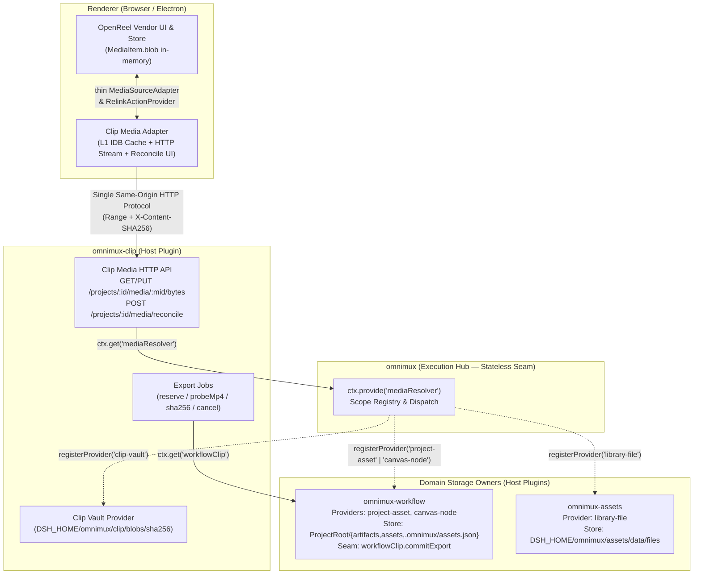

# 架构重构 Spec：跨插件统一媒体句柄、画布同步重连与成片入项目库

> 状态：Implemented（Phases 0–3 已在工作树实现，待最终全量门禁与浏览器实测验收）
> 关联背景：OpenReel v1 接入（`#154`）、实时控制与画布回写（`#159` / `#170`）、资产库与画布回流（`#158` / `#181`）、成片回写避让（`#175`）
> 适用范围：`omnimux`（执行中心中性 Seam）、`omnimux-workflow`（项目库/画布）、`omnimux-assets`（全局资产库）、`omnimux-clip`（OpenReel 剪辑工坊）

---

## 1. 问题定义与架构根因

### 1.1 现象与一阶断点
在画布上已有可播放的上游素材节点（及已导出的下游成片节点）的情况下，进入 `video_composition` 剪辑界面后，素材池可能全部显示「缺失 / 媒体离线」且主监视器「无法预览」。实证定位到四重结构性断层：

1. **字节权威源错位**：`omnimux-clip` 落盘工程时剥离 `blob` / `fileHandle` / `path` / `originalUrl`（`plugins/plugins/omnimux-clip/src/client/live/native-state.ts`、`src/store/nativeProject.js`），使浏览器 IndexedDB（`openreel-db/media` + `omnimux-clip-projects/drafts`）成为媒体字节的**唯一在线持有者**。一旦发生升级迁移、清缓存或 Web Origin 变动（如动态端口），所有素材立刻离线。
2. **严格 SHA-256 重连与 5 套异构 URL 协议分裂**：
   - `native-state.ts`（`recoverMedia`）在缺失 64 位 `sha256` 时直接落入占位离线态；
   - `useCanvasIngestion.ts` 既在已初始化工程上直接短路，又在 `recoverCanvasMedia` 中跳过非 `legacy` 的工作区 URL 和一切无 `sha256` 摘要的素材；
   - 而工作区导入素材（`resourcePickerPolicy.ts`）、历史生成产物、`/omnimux-workflow/media/`、`/omnimux-workflow/api/local-file`、资产库导入（`bridged-media.ts` 丢弃 `url`）与 Agent `clip_edit(import_media)`（`native-media.ts` 丢弃 `url`）各自使用不同协议且多数不带 `sha256`。
3. **重连交互语义错位**：OpenReel 上游的「重新关联」按钮（`AssetsPanel.tsx`）调用 OS `showDirectoryPicker` 按 `filename:size` 匹配本地目录，在画布模式下无法关联项目产物目录和全局资产库。
4. **导出闭环断裂**：Clip 导出 MP4 落在 `<DSH_HOME>/omnimux/clip/exports/jobs/<id>/video.mp4`，以 `/omnimux-workflow/api/local-file?path=...&rev=mtimeMs:size` 回写画布（`export-jobs.js`、`workflowClip.ts`、`videoCompositionDownstream.ts`），既**未进入 `<ProjectRoot>/artifacts/` 与 `.omnimux/assets.json`**，也无内容 `sha256`，导致成片无法无损串联到二级合成节点，也锁死了未来项目整包迁移与分享。

### 1.2 为什么不能只在客户端打补丁
继续在 `useCanvasIngestion.ts` / `native-state.ts` 增加放宽分支会固化以下二阶/三阶技术债：
- 剪辑客户端被迫理解全部上游插件的私有 URL 格式与安全规则，跨插件耦合按 $O(N^2)$ 扩张；
- 浏览器端对大视频反复调用 `blob.arrayBuffer()` 做 SHA-256（`media-source.ts`）引发大文件内存峰值；
- 每次跟进 OpenReel 上游版本都要在 `AssetsPanel.tsx` / `project-store.ts` 承担高额合并税；
- 一个完整创作项目的物理文件被切碎在 5 个互不管辖的存储域，项目无法自包含。

---

## 2. 架构目标与不可违反的边界（Invariants）

### 2.1 三大架构收敛目标
1. **Host 侧单一媒体事实源（Unified Media Handle + Host-First Resolution）**：
   - IndexedDB 降级为**可随时清空的 L1 解码/离线缓存**，不再承担媒体字节唯一持久化职责；
   - 通过 `omnimux` 执行中心提供的**无状态中性 Seam `mediaResolver`**，由各领域插件注册自有存储的 Provider，向剪辑端及未来新引擎暴露**统一、版本化、内容校验的媒体句柄（`MediaHandle v1`）**。
2. **画布同步与重连一等公民化（First-Class Canvas Reconcile & Relink）**：
   - 区分「精确恢复」「存量无摘要受控升级」「上游源已更新」「上游断连/文件丢失」四类状态；
   - 在画布模式下提供以画布上游连线为权威源的「从画布同步/重新关联」能力，保留原 `mediaId` 与时间轴剪辑点，不静默篡改用户素材内容。
3. **画布成片入项目库闭环（Export-to-Project-Artifacts）**：
   - 绑定项目的画布合成导出 MP4 统一落盘到 `<ProjectRoot>/artifacts/` 并登记到 `<ProjectRoot>/.omnimux/assets.json`（含 `sha256` 与 `clip_export` 血缘），下游节点直接持有可验证的 `project-asset` 句柄与 `rev=sha256:...` URL，彻底打通「生成 → 一级合成 → 二级合成 → 成片归档」。

### 2.2 必须遵守的仓库硬约束
- **Hub 不持有领域存储**（`plugins/plugins/omnimux/AGENTS.md`）：`omnimux` 只提供无状态路由/注册 Seam（`mediaResolver`），不读写 `assets.json`、`library.json`、`projects/*.json` 或媒体文件。
- **插件依赖隔离**（`plugins/scripts/verify-plugin-boundaries.mjs`）：禁止任何跨插件私有模块 `import`；所有跨插件协作仅通过 Cordis `ctx.provide` / `ctx.get` 公共 Seam 完成；客户端 `src/client/` 严禁引入 Node 原生模块。
- **最小化 OpenReel Vendor 侵入**（`plugins/docs/contracts/openreel-vendor-contract.md`）：`src/client/openreel/` 内仅允许注入最薄的适配点（媒体字节加载回调 + 重连操作回调），不在上游源码中硬编码 Workflow/Assets 协议。
- **安全与隐私红线**：Clip 持久化工程 JSON、Agent 工具投影（`clip_get` / `clip_diagnostics`）与 `<ui_context>` 严禁泄露宿主机绝对路径；所有文件读取坚持 lexical + `realpath` 双重 containment、`O_NOFOLLOW`、魔数 MIME 嗅探、禁用 SVG/脚本、块级校验流式传输。
- **删除与回退安全**（`plugins/AGENTS.md`）：永不删除用户外部原始文件；被引用资产不得被 GC 清理；物理清理失败不得抹除账本记录；存量无摘要升级前必须写入 `.backups/` 备份。

---

## 3. 目标系统架构

### 3.1 总体分层与依赖拓扑



### 3.2 核心数据契约：`MediaHandle v1`

所有跨插件流转并持久化在 Clip 工程 JSON 中的媒体引用，统一收敛为可序列化的 `MediaHandle` 联合类型（不含宿主机绝对路径）：

```ts
export type Sha256Hex = string; // /^[a-f0-9]{64}$/

export type MediaHandleV1 =
  | {
      v: 1;
      scope: 'project-asset';
      workspaceId: string;        // ws_*
      assetId?: string;           // ast_* in .omnimux/assets.json
      rel: string;                // POSIX project-relative path, e.g. "artifacts/..." or "assets/imported/..."
      sha256?: Sha256Hex;         // 首次校验后必填固定；存量读入允许暂缺并在 reconcile 时补全
    }
  | {
      v: 1;
      scope: 'library-file';
      libraryAssetId: string;     // omnimux-assets record id
      fileId: string;             // file id within record
      sha256?: Sha256Hex;
    }
  | {
      v: 1;
      scope: 'clip-vault';
      sha256: Sha256Hex;          // 内容寻址，天然不可变
      mimeType: string;           // video/mp4 | image/png | audio/mpeg ...
      size: number;
    }
  | {
      v: 1;
      scope: 'canvas-node';       // 专用于画布未入库外链节点（如未 copy 的 /api/local-file）或存量迁移锚点
      workspaceId: string;
      nodeId: string;
      outputIndex: number;        // 0-based
      sha256?: Sha256Hex;
    };
```

#### 在 Clip 工程 `MediaItem` 中的落盘形态
在 `plugins/plugins/omnimux-clip/src/store/nativeProject.js` 规范化 `MediaItem` 时，保留向后兼容字段，同时引入 `omnimuxSource.handle` 作为主权威坐标：

```json
{
  "id": "media-uuid-1",
  "name": "视频分镜 1 | 0-5s Hook动作建立",
  "type": "video",
  "metadata": { "duration": 5.04, "width": 720, "height": 1280, "fileSize": 1823400 },
  "omnimuxSource": {
    "id": "ws_abc:node_1:0",
    "version": "sha256:<64hex>",
    "digest": "<64hex>",
    "handle": {
      "v": 1,
      "scope": "project-asset",
      "workspaceId": "ws_abc",
      "assetId": "ast_9f12a0...",
      "rel": "artifacts/1795400000_node_1.mp4",
      "sha256": "<64hex>"
    }
  },
  "sourceRef": {
    "kind": "host-handle",
    "digest": "<64hex>",
    "cacheKey": "sha256:<64hex>"
  },
  "missing": false,
  "isPlaceholder": false
}
```

> **兼容策略**：旧版工程只有 `sourceRef.kind === 'indexeddb' | 'legacy'` 且没有 `omnimuxSource.handle` 时，Host 读取层通过 `deriveHandleFromLegacyItem(item, binding)` 无损推导出候选句柄（例如从 `sourceRef.url` / `omnimuxSource.url` 解析出 `project-asset`，或通过画布绑定交由 `reconcile` 匹配 `canvas-node`），不破坏任何存量 JSON 读取。

---

## 4. 模块接口详细设计

### 4.1 `omnimux` 执行中心：中性 `mediaResolver` Seam

新增文件：`plugins/plugins/omnimux/src/host/media-resolver.js`，在 `plugins/plugins/omnimux/src/host/apply.js` 中注册 `ctx.provide('mediaResolver', ...)`。

```ts
export interface MediaAuthContext {
  sessionId?: string;
  /** 仅用于作用域校验，不信任来自客户端的任意路径 */
  projectBinding?: { workspaceId: string; nodeId: string; projectId: string };
  allowUnsignedRead?: boolean; // 仅在显式升级/探测路径由 Host 内部置 true
}

export interface MediaStatResult {
  status: 'ok' | 'digest_mismatch' | 'not_found' | 'access_denied' | 'unsupported';
  exists: boolean;
  canonicalHandle?: MediaHandleV1;
  currentSha256?: Sha256Hex;
  size?: number;
  mimeType?: string;
  displayName?: string;
  immutable?: boolean;
}

export interface ResolvedMediaStream {
  canonicalHandle: MediaHandleV1;
  sha256: Sha256Hex;
  size: number;
  mimeType: string;
  displayName: string;
  /** 返回按 256KB 块校验的只读字节流（复用 verifiedMediaBytes 模式），支持 Range */
  openRange: (start: number, end: number, signal?: AbortSignal) => AsyncIterable<Buffer>;
}

export interface MediaScopeProvider {
  scope: MediaHandleV1['scope'];
  stat(handle: MediaHandleV1, auth: MediaAuthContext, signal?: AbortSignal): Promise<MediaStatResult>;
  open(handle: MediaHandleV1, auth: MediaAuthContext, signal?: AbortSignal): Promise<ResolvedMediaStream>;
}

export interface MediaResolverSeam {
  /** 各领域插件在 apply() 中通过 ctx.effect 注册，卸载时自动释放 */
  registerProvider(provider: MediaScopeProvider): () => void;
  stat(handle: MediaHandleV1, auth: MediaAuthContext, signal?: AbortSignal): Promise<MediaStatResult>;
  open(handle: MediaHandleV1, auth: MediaAuthContext, signal?: AbortSignal): Promise<ResolvedMediaStream>;
}
```

**边界检查**：`mediaResolver` 自身只有 `Map<scope, MediaScopeProvider>` 路由表 + 句柄 schema 预校验，零磁盘 I/O，零领域状态，完全符合 `plugins/plugins/omnimux/AGENTS.md`。

---

### 4.2 `omnimux-workflow`：项目资产 Provider、SHA-256 账本与成片入库

#### A. 升级 `.omnimux/assets.json` 与 `projectFileMediaUrl`
- `plugins/plugins/omnimux-workflow/src/shared/projectAssets.ts`：`ProjectAssetsItem` 新增可选持久化字段 `sha256?: string`（64 位小写 hex）。
- `ProjectAssetsStore.ts`：
  - `ingest()`（复制外部文件到 `assets/imported/`）与 `registerGenerated()`（写入 `artifacts/`）落盘后即复用 `readMediaContentDigest()`（`src/projects/mediaRevision.ts`）计算并写入 `sha256`；
  - 读取旧版无 `sha256` 账本项时，在 `mediaResolver.stat/open` 首次访问时惰性计算（复用 `readMediaIntegrity` 内存缓存），不阻塞冷启动列表扫描。
- 所有构造工作区文件 URL 的位置（`resourcePickerPolicy.ts`、`flattenProjectAssets.ts`、`assetImportAdapter.ts`、`persistGeneratedArtifact.ts`）当账本项存在 `sha256` 时统一附带 `&rev=sha256:<digest>`。

#### B. 注册 `project-asset` 与 `canvas-node` Providers
新增文件：`plugins/plugins/omnimux-workflow/src/workflow/media/workflowMediaProviders.ts`，在 `workflow/index.ts` 通过 `ctx.effect` 注册到 `ctx.get('mediaResolver')`：
- **`project-asset` Provider**：
  1. 校验 `canAccessWorkspace(handle.workspaceId, auth.sessionId)`；
  2. 优先按 `handle.assetId` 在 `ProjectAssetsStore` 查找 `relative_path`，若缺失或仅传 `rel` 则经 `resolveSafeProjectPath(projectRoot, handle.rel)` 双重 containment 解析；
  3. 调用 `readMediaIntegrity(file)`（256KB 块哈希 + 魔数 MIME 嗅探 + 拒绝对 SVG/非媒体提供服务）；
  4. 若 `handle.sha256` 存在且与当前磁盘不一致：返回 `digest_mismatch`（`open()` 拒绝返回字节，防止静默换片）；
  5. `openRange()` 复用 `verifiedMediaBytes()`，确保流式读取过程中文件被覆盖时立即中止。
- **`canvas-node` Provider**：
  1. 校验 `canAccessWorkspace(handle.workspaceId, auth.sessionId)`；
  2. 读取 `WorkspaceStore.get(handle.workspaceId)` 找到目标 `nodeId`（仅允许 `material` / `video_composition` 节点）；
  3. 解析节点当前输出：
     - 若指向工作区文件 -> 委托 `project-asset` 校验并返回升级后的 `canonicalHandle`（`scope: 'project-asset'`）；
     - 若指向已登记的本地外链（`/api/local-file?path=...`）或历史 `/omnimux-workflow/media/...` -> 经 `resolveReadableFile` + `readMediaIntegrity` 校验；不向调用方暴露物理路径，返回 `canonicalHandle`（`scope: 'canvas-node'` + 当前实测 `sha256`）。

#### C. 扩展 `workflowClip` Seam：上游快照查询 + 成片入项目库
在 `plugins/plugins/omnimux-workflow/src/workflow/clip/workflowClip.ts` 扩展两个方法（保持原有 `getNode` / `saveDraft` / `commitExport` 签名向后兼容）：

1. **`listUpstreamSources({ workspaceId, nodeId, projectId }, sessionId)`**：
   - Host 侧直接读取持久化 `canvas.json` 中指向 `nodeId` 的所有上游连线与节点，返回权威上游媒体列表（含 `nodeId`、`outputIndex`、`materialType`、`name`、`durationMs`、`mediaHandle`、`legacyFingerprints`、`currentSha256`）。
   - 这是画布模式 `reconcile` 与 Agent `relink_media` 的权威数据源，不再仅依赖前端 DOM 事件携带的瞬时 `upstreamInputs`。

2. **升级 `commitExport(input)` — 成片自动入项目 `artifacts/`**：
   ```mermaid
   sequenceDiagram
       participant Client as Clip Editor (WebCodecs)
       participant ClipHost as omnimux-clip Host (export-jobs.js)
       participant WfClip as omnimux-workflow (workflowClip.commitExport)
       participant Disk as ProjectRoot/artifacts & .omnimux/

       Client->>ClipHost: POST /exports/reserve (binding, revision, epoch)
       ClipHost-->>Client: { exportJobId, uploadToken }
       Client->>ClipHost: POST /exports/:id/upload (raw MP4 stream)
       ClipHost->>ClipHost: probeMp4() + compute sha256 + persist exports/jobs/:id/video.mp4
       ClipHost->>WfClip: commitExport({ binding, exportJobId, projectRevision, exportGeneration, output: { videoPath, sha256, durationMs, width, height } })
       WfClip->>WfClip: Verify binding, idempotency receipt & exportGeneration
       alt Bound to Local ProjectRoot
           WfClip->>Disk: Hardlink/atomic-copy into artifacts/clip_<nodeId>_job<id>_<sha8>.mp4
           WfClip->>Disk: ProjectAssetsStore.registerGenerated() -> ast_* (with sha256 + clip_export lineage)
           WfClip->>WfClip: Build outputVideoUrl = projectFileMediaUrl(ws, rel, sha256) + mediaHandle
       else Free Canvas (Unbound)
           WfClip->>WfClip: Fallback to clipExportMediaUrl(videoPath, "sha256:" + sha256)
       end
       WfClip->>Disk: WorkspaceStore.save(expectedVersion) -> update source node + downstream material node
       WfClip-->>ClipHost: { status: 'committed', workspaceVersion, mediaHandle, outputVideoUrl }
       ClipHost->>ClipHost: Persist canvas.json receipt; prune duplicate exports/jobs/:id/video.mp4 if materialized
   ```

   **关键细节**：
   - **零双倍磁盘占用**：同文件系统优先 `fs.linkSync` 硬链接，跨分区退化为原子临时文件复制 + `renameSync`；`canvasCommitted === true` 后清理 `exports/jobs/<id>/video.mp4` 临时副本（保留 `<2KB` 的 `file.json` + `canvas.json` 回执）。
   - **重试幂等性**：若 `WorkspaceStore.save()` 失败（`canvas-failed`），`exports/jobs/<id>/video.mp4` 保持不删；下次调用 `retryCanvas(exportJobId)` 时，根据 `exportJobId` + `sha256` 幂等复用已落盘的 `artifacts/` 文件并重试图提交。
   - **下游节点复用兼容**：`planClipExportDownstream` 继续按 `origin: 'clip_export'` + `sourceCompositionNodeId` 识别已有下游节点。老画布上的旧成片节点（原为 `/api/local-file`）在下次重导出时原地无感升级为 `projectFileMediaUrl(..., sha256)` + `mediaHandle`，保留用户拖动后的坐标与下游连线。
   - **二次剪辑打通**：下游成片节点携带 `mediaHandle`（`scope: 'project-asset'` + `sha256`）和 `rev=sha256:...` URL，直接连入第二个 `video_composition` 节点时享受 100% 一等媒体恢复与校验能力。

---

### 4.3 `omnimux-assets`：全局资产库 Provider

新增文件：`plugins/plugins/omnimux-assets/src/media-provider.js`，在 `omnimux-assets/src/index.js` 注册 `library-file` Provider：
- 通过 `(libraryAssetId, fileId)` 查 `library.js` 托管副本（`<DSH_HOME>/omnimux/assets/data/files/<id>/`）；
- 为 `library.json` 中的托管文件条目补充可选 `sha256` 字段（新增/入库时计算，历史条目首次 `stat/open` 时惰性计算并缓存）；
- 严禁对外暴露外部未托管原始路径或已软删除记录；`openRange` 同样采用 256KB 块哈希校验。
- **直接修复 #181 断点**：从资产库导入剪辑的素材不再丢失回源坐标，而是写入 `{ v: 1, scope: 'library-file', libraryAssetId, fileId, sha256 }`。即使浏览器清空 IndexedDB，重新打开工程也能毫秒级自动从 Host 资产库恢复。

---

### 4.4 `omnimux-clip`：Host 统一媒体流、Clip Vault、Reconcile 引擎与客户端薄适配

#### A. Clip Vault（独立工坊/本地导入托管仓）
- 目录：`<DSH_HOME>/omnimux/clip/blobs/sha256/<digest[0..1]>/<digest>`（复用 `resolveClipPaths`，权限 `0o700` / `0o600`）。
- **什么时候写入 Clip Vault**：
  - 独立 Studio 中用户从本地磁盘导入文件、浏览器录屏/录音生成的媒体；
  - 画布模式下，用户在剪辑器内直接选择本地文件导入时：**若画布已绑定项目，优先调用 `workflowClip` 入库到 `<ProjectRoot>/assets/imported/`（生成 `project-asset` 句柄）；未绑定项目则落入 `clip-vault`**。
  - **画布已有产物与全局资产库文件绝不重复拷入 `clip-vault`**。
- **GC 安全边界**：每次写入/保存工程更新轻量引用索引或由后台安全清扫器扫描 `projects/*.json` + `.backups/*.json` 中的 `clip-vault` 摘要集合，仅回收无引用且超过宽限期（默认 7 天）的 blob。

#### B. 统一 Clip Host HTTP 媒体接口
在 `plugins/plugins/omnimux-clip/src/http/routes.js` 新增 3 个同源认证端点（沿用现有 `request-authorization.js` 窗口/会话认证）：

| 方法与路径 | 职责 | 关键头 / 返回契约 |
| --- | --- | --- |
| `GET /omnimux-clip/api/projects/:projectId/media/:mediaId/bytes` | 按工程中该 `mediaId` 绑定的 `mediaHandle`（或合法推导的存量句柄）读取校验后的字节流 | 支持 `Range`、`If-None-Match`；响应头带 `Content-Type`、`Content-Length`、`X-Content-SHA256`、`ETag: "<sha256>"`、`X-Content-Type-Options: nosniff`；摘要不匹配返回 `409 { error: 'media-version-mismatch' }`；未找到返回 `404` |
| `PUT /omnimux-clip/api/projects/:projectId/media/:mediaId/bytes` | 接收浏览器本地文件/录屏的原始流上传，Host 侧流式算 SHA-256 + 魔数嗅探 + 落盘（项目 `assets/imported/` 或 `clip-vault`） | `Content-Type: application/octet-stream` + `X-Clip-Media-Name`；返回 `{ handle: MediaHandleV1, sha256, size, mimeType }` |
| `POST /omnimux-clip/api/projects/:projectId/media/reconcile` | 核对当前工程所有媒体项的 Host 可达性 +（画布模式）与当前上游连线的差集，可选执行 `apply` | 见下文 4.4.C 详细状态机 |

#### C. `reconcile` 状态机与存量无摘要受控升级规则

`POST /omnimux-clip/api/projects/:projectId/media/reconcile` 请求体：
```json
{
  "mode": "inspect" | "apply",
  "binding": { "workspaceId": "ws_...", "nodeId": "node_...", "projectId": "clip_node_..." },
  "actions": [
    { "mediaId": "m1", "action": "auto_upgrade_legacy" },
    { "mediaId": "m2", "action": "sync_from_upstream", "sourceNodeId": "node_src_2", "outputIndex": 0 },
    { "mediaId": "m3", "action": "rebind_handle", "handle": { "v": 1, "scope": "library-file", "..." : "..." } }
  ]
}
```

每个 `MediaItem` 的诊断分类严格互斥、可审计：

| 诊断状态 (`reconcileState`) | 判定条件 | 默认行为（打开工程时） | 用户/Agent 可执行动作 |
| --- | --- | --- | --- |
| `online_exact` | `handle` 存在且 `mediaResolver.stat()` 返回 `ok`（`sha256` 一致） | L1 IDB 命中直接用，未命中自动 `GET .../bytes` 无感恢复 | 无需操作 |
| `legacy_unsigned_exact` | 工程项无 `sha256`（历史草稿 / 未签名导入节点 / `/media/`），但通过 `binding` 命中**唯一**已连接上游节点（按 `sourceId` 或 `sourceFingerprint` 匹配），且 `type` 一致、时长误差 `<= 0.15s`（或旧记录 `duration === 0`） | **允许自动受控升级**：先写 `.backups/` 备份，补写 `mediaHandle` + `sha256`，随即可通过 `GET .../bytes` 恢复（仅针对本次打开的缺失占位项，不改已在线项） | 自动完成；若用户撤销或需审计可查备份 |
| `source_drifted` | 同源 `nodeId` / `assetId` 仍存在，但 `currentSha256 !== expectedSha256`（例如上游节点刚重新生成了视频） | **禁止静默替换**！若旧版本仍存在于 L1 IDB 缓存则继续播旧版并提示「上游有新版」；若旧版字节已丢失则标记 `source_updated` | 一键「采用画布最新版本」（保 `mediaId` 更新素材并校验裁剪入出点）或「另行导入为新素材」 |
| `legacy_ambiguous` | 历史无摘要项匹配到多个上游候选，或类型/时长显著不符（`> 0.15s`） | 保持离线，绝不盲猜 | 在「从画布重新关联」弹窗中由用户指定对应上游节点 |
| `missing_unlinked` | 句柄目标文件已被删除且无可用上游连线匹配 | 标记真实离线 | 「从画布重新关联」「从资产库替换」「从本地文件替换」 |

同时，`reconcile` 返回 `unimportedUpstreams[]`（画布当前已连接但尚未进入剪辑素材池的新上游节点），彻底解决「工程初始化一次后，再连新上游节点既不自动进池也没有入口同步」的断层！

#### D. 客户端改造：L1 缓存降级 + 去除大文件 RAM Hash + 极薄 Vendor Seam
1. **新建 `plugins/plugins/omnimux-clip/src/client/live/media-adapter.ts`**：
   - `loadMediaBlobForItem(projectId, item, signal)`：
     1. 若有 `sha256`，先查 L1 IDB（`openreel-db/media` 按 `cacheKey` 查）；命中时不再强制对数百 MB 文件执行 `blob.arrayBuffer()`（仅校验非空 + 记录的 `digest` 元数据）；
     2. L1 未命中 -> `fetch('/omnimux-clip/api/projects/:id/media/:mid/bytes', { credentials: 'same-origin', redirect: 'error', signal })`；
     3. 读取响应头 `X-Content-SHA256` 与预期摘要比对（Host 侧已做 256KB 块级 SHA-256 校验），将得到的 `Blob` 异步回填 L1 IDB 缓存，直接返回给 OpenReel `restoreMediaItem()`。
   - `persistLocalMediaToHost(projectId, mediaId, file, signal)`：
     - 用户在剪辑界面点击「本地文件导入」或「录制」时，OpenReel 正常导入并可立即编辑，同时后台通过 `PUT /projects/:id/media/:mid/bytes` 流式持久化到 Host（项目 `assets/imported/` 或 `clip-vault`），拿到 `MediaHandleV1` 后随下一次草稿保存落盘。在 Host 确认持久化前，草稿仍保留 IDB 备份并在保存屏障前完成上传（遵循现有 `editor-session.js` 交接屏障）。
2. **OpenReel Vendor 最小侵入点（仅 2 处）**：
   - `plugins/plugins/omnimux-clip/src/client/openreel/web/components/editor/AssetsPanel.tsx`：接受外部注入的 `relinkHandler`（通过现有 Context/Bridge）。画布模式下点击「重新关联」按钮不再直接调 `showDirectoryPicker`，而是打开 OmniMux 的 **画布同步与重连面板**（遵循 `AGENTS.md` 硬约束 #2 和 #3：使用 `dsh-ui-kit` + `--dsw-alias-*` Token，且实施前交付高保真 HTML 演示）。
   - `plugins/plugins/omnimux-clip/src/client/openreel/web/stores/project-store.ts`：`importMedia` 完成后触发可选 `onLocalMediaImported` hook，供外部 `media-adapter.ts` 持久化到 Host。
3. **收敛旧客户端逻辑**：
   - `useCanvasIngestion.ts` 从 385 行缩减为薄协调器：首次空工程仍保留首个视频自动定画幅+入轨和字幕导入；已有工程打开时不再短路放弃恢复，而是触发一次 `reconcile(inspect)` -> 对 `legacy_unsigned_exact` 自动执行受控升级并加载字节；对 `source_drifted` / `unimportedUpstreams` 驱动媒体面板上的「从画布同步」轻入口（遵守 Show, Don't Tell，不弹冗余 Toast 复读）。

---

### 4.5 Agent 工具升级与能力对齐

对 `plugins/plugins/omnimux-clip/src/tools.js` 与 `src/client/live/run-command.ts` 做以下最小必要扩展（保持现有 9 个工具名不变，遵守 `plugins/docs/contracts/plugin-agent-tools-inventory.md`）：

1. **`clip_diagnostics`**：
   - `media_missing` 问题增加结构化字段：`reason`（`cache_miss_recoverable` | `legacy_unsigned_exact` | `source_drifted` | `legacy_ambiguous` | `missing_unlinked`）、`recoverable: boolean`、`suggestedSourceNodeId?: string`。
2. **`clip_edit`**：
   - `import_media` 操作支持通过 Host `mediaResolver` 消费三种已授权引用（三选一）：
     - `path`（现有：会话工作区内相对/本地文件，兼容保留）
     - `libraryAssetId` + 可选 `fileId`（全局资产库）
     - `canvasNodeId` + 可选 `outputIndex` 或 `projectAssetId`（当前画布上游节点/项目资产）
   - 新增 `relink_media` 操作：`{ type: 'relink_media', mediaId, source: { canvasNodeId?, outputIndex?, projectAssetId?, libraryAssetId?, fileId?, path? }, allowVersionUpdate?: boolean }`。
     - 默认 `allowVersionUpdate: false`（仅允许同 `sha256` 或存量无摘要受控升级）；显式传 `true` 时允许更新到新版本并自动校验引用该素材的片段入出点（超长裁剪返回明确诊断而非静默越界）。
3. **零路径泄露**：所有返回结果只投影 `mediaId`、`omnimuxSource.id`、`version`、`scope`，绝不返回宿主机绝对路径。

---

## 5. 架构决策与关键取舍（需评审拍板）

| 编号 | 决策点 | 推荐方案 | 备选方案 | 取舍依据 |
| --- | --- | --- | --- | --- |
| **D1** | **存量无 SHA-256 画布工程的首次恢复策略** | **单候选 + 类型/时长吻合时自动受控升级**（先写 `.backups/`，补写 `handle` + `sha256` 后恢复）；多候选或时长漂移 `>0.15s` 时停在弹窗由用户确认 | 全部停在离线态，强制用户手动点一次「从画布重新关联」 | 推荐方案可让现有历史画布用户（如当前问题截图）升级后**零感知自愈**，同时保留备份与严格校验，防止错配换片 |
| **D2** | **画布模式下「在剪辑器内直接选本地文件导入」的物理落点** | 若画布已绑定项目，自动入库到 **`<ProjectRoot>/assets/imported/`** 并生成 `project-asset` 句柄；未绑定自由画布或独立 Studio 落入 `clip-vault` | 全部统一落入 `<DSH_HOME>/omnimux/clip/blobs/` | 推荐方案让项目文件夹 `<ProjectRoot>` 天然自包含，且导入的本地素材在画布项目资产面板中也可见、可复用 |
| **D3** | **画布成片 `artifacts/` 落盘后的 `exports/jobs/<id>/video.mp4` 保留策略** | 同盘硬链接 / 跨盘复制进 `<ProjectRoot>/artifacts/` 且 `canvasCommitted === true` 后，**清理 `exports/jobs/<id>/video.mp4`**（保留 `<2KB` 回执 JSON） | 长期保留两份完整 MP4 副本 | 避免导出大视频导致磁盘翻倍，同时 `canvas-failed` 期间仍保留副本以保证 `retryCanvas` 幂等 |
| **D4** | **剪辑工程 JSON 本身是否迁入 `<ProjectRoot>/.omnimux/clip/`** | **本阶段不迁**（仍留 `<DSH_HOME>/omnimux/clip/projects/`，保持 `projectStore.js` 零破坏与低风险）；预留 Phase 4 项目整包导出时再按绑定打包/镜像 | 本次同步把画布绑定的 `clip_node_*.json` 迁入 `<ProjectRoot>/.omnimux/clip/` | 拆分风险面：先彻底解决媒体字节、句柄、重连、导出四大断层，再独立处理工程 JSON 物理位置迁移，避免把 CAS 租约与目录迁移混在一个 PR 里 |

---

## 6. 分阶段实施路线与验证门禁

每个阶段独立开 worktree 与 PR，独立通过门禁与真机验收，支持随时按阶段止损或回滚。

### Phase 0：中性 Seam + 统一媒体流 + 存量离线自愈（优先止血 + 打地基）
- **改动范围**：
  - `plugins/plugins/omnimux/src/host/media-resolver.js` & `apply.js`（提供 `mediaResolver`）
  - `plugins/plugins/omnimux-workflow/src/shared/projectAssets.ts`、`ProjectAssetsStore.ts`、`workflowMediaProviders.ts`、`workflowClip.ts`（`sha256` 账本 + `project-asset`/`canvas-node` Provider + `listUpstreamSources`）
  - `plugins/plugins/omnimux-assets/src/media-provider.js` & `index.js`（`library-file` Provider）
  - `plugins/plugins/omnimux-clip/src/store/nativeProject.js`、`src/http/routes.js`、`src/media/reconcile.js`（`MediaHandleV1` 落盘、`GET .../bytes`、`POST .../reconcile`）
  - `plugins/plugins/omnimux-clip/src/client/live/native-state.ts`、`bridged-media.ts`、`useCanvasIngestion.ts`（接入 Host 流式恢复与受控升级）
- **直接收益**：截图场景中的 4 项素材（含历史生成节点、导入素材、资产库素材）在清 IDB 或跨版本打开后自动恢复可预览，无需手工重连。

### Phase 1：Host-First 本地导入持久化 + 画布重连 UI（含 HTML 演示先行）
- **改动范围**：
  - `plugins/plugins/omnimux-clip/src/media/clipVault.js` + `PUT .../bytes`（独立 Studio / 本地导入 / 录屏不再只存 IDB）
  - `plugins/plugins/omnimux-clip/src/client/live/media-adapter.ts`（移除大文件客户端 `arrayBuffer()` hash，改为信任 Host `X-Content-SHA256`）
  - 先交付高保真 HTML 交互演示（亮/暗主题、宽/窄屏、画布重连面板、上游更新提示、离线替换），评审通过后再落地薄注入 `AssetsPanel.tsx` + OmniMux 侧重连面板。

### Phase 2：画布成片入 `<ProjectRoot>/artifacts/` 闭环
- **改动范围**：
  - `plugins/plugins/omnimux-clip/src/export-jobs.js`（在 `probeMp4` 阶段同步计算 `sha256`，透传给 `commitExport`，提交成功后回收重复视频副本）
  - `plugins/plugins/omnimux-workflow/src/workflow/clip/workflowClip.ts` & `videoCompositionDownstream.ts`（硬链接/复制至 `artifacts/`、`registerGenerated` 登记 `clip_export` 血缘、下游节点写入 `projectFileMediaUrl(..., sha256)` + `mediaHandle`）
  - 保留对旧 `/api/local-file` 下游节点的只读兼容与重导出原地升级。

### Phase 3：Agent 工具补齐 + 遗留多协议清理 + 文档同步
- **改动范围**：
  - `plugins/plugins/omnimux-clip/src/tools.js` & `run-command.ts`（`clip_edit(import_media)` 支持 `libraryAssetId` / `canvasNodeId` / `projectAssetId`；新增 `relink_media`；`clip_diagnostics` 结构化原因）
  - 清理 `useCanvasIngestion.ts` / `media-bridge-source.js` 中冗余的多套客户端 URL 正则与兼容分支；
  - 同步更新 `plugins/docs/contracts/clip-live-control.md`、`plugins/docs/contracts/openreel-vendor-contract.md`、`plugins/docs/contracts/plugin-agent-tools-inventory.md`、`docs/subsystems.md`。

---

## 7. 证伪方式与验收矩阵

| 验收编号 | 对应阶段 | 同一测试的操作与可观察判定 |
| --- | --- | --- |
| **AC-CMU-01** | Phase 0 | 在画布连接 3 个历史/导入视频 + 1 个音频（刻意不含 `rev=sha256:`）进入 `video_composition`；随后彻底清空浏览器 IndexedDB（`openreel-db` 与 `omnimux-clip-projects`）并刷新重开节点。判定：4 项素材自动通过 `reconcile` 升级并由 `GET .../bytes` 恢复，0 项离线，主监视器正常出帧，`.backups/` 存有升级前原档。 |
| **AC-CMU-02** | Phase 0 | 从全局资产库导入图片/视频/音频到 Studio 与画布 Portal，保存后清空 IndexedDB 重开。判定：所有资产库素材通过 `library-file` 句柄自动恢复，无离线占位。 |
| **AC-CMU-03** | Phase 0 | 篡改磁盘上某 `project-asset` 文件内容（保持文件名不变）后打开剪辑工程。判定：`GET .../bytes` 返回 `409 media-version-mismatch`，工程**绝不静默替换**素材，面板标记「上游已更新」并允许用户明确确认后同步。 |
| **AC-CMU-04** | Phase 1 | 在独立 Studio 与画布 Portal 中分别通过「本地文件导入」导入外部视频并保存，随后清空 IndexedDB 并更换 Origin/重开页面。判定：画布模式视频落盘在 `<ProjectRoot>/assets/imported/` 且登记在 `assets.json`，Studio 模式视频落在 `clip-vault`，两者均自动恢复可播。 |
| **AC-CMU-05** | Phase 1 | 在画布模式下断开某上游连线并清除缓存制造真实离线，再在画布重连另一个新节点，进入剪辑点击「从画布重新关联」。判定：不弹出 OS `showDirectoryPicker`，在 OmniMux 重连面板（亮/暗双主题、宽/窄屏均无遮挡与透明浮层）完成绑定，原时间轴片段与 `mediaId` 保持不变。 |
| **AC-CMU-06** | Phase 2 | 执行画布导出（手工导出与 Agent `clip_export` 各一次）。判定：MP4 落盘在 `<ProjectRoot>/artifacts/`、登记在 `.omnimux/assets.json`（含 `sha256` 与 `clip_export` 血缘），下游成片节点 `mediaUrl` 为带 `rev=sha256:...` 的工作区 URL，且 `exports/jobs/<id>/video.mp4` 冗余副本已回收；将该下游成片节点连入第二个 `video_composition` 节点并清空 IDB 重开，二级合成仍正常预览与二次导出。 |
| **AC-CMU-07** | Phase 2 | 注入 `WorkspaceStore.save()` 首次失败制造 `canvas-failed`，验证 `exports/jobs/<id>/video.mp4` 保留；触发 `retryCanvas` 后成功落盘 `artifacts/` 并提交画布，无重复文件或重复下游节点；验证存量旧 `/api/local-file` 下游节点在重导出后原地升级并保留用户拖动后的坐标。 |
| **AC-CMU-08** | Phase 3 | 经 Agent 调用 `clip_diagnostics` 定位离线原因，调用 `clip_edit(relink_media)` 与 `clip_edit(import_media, { libraryAssetId })` 修复并导出。判定：工具返回与持久化工程 JSON 中均不含宿主机绝对路径，撤销栈可完整回退，离线/跨工作区越权句柄均返回 `path-denied` / `access_denied`。 |

### 必需静态与回归检查命令
- `corepack pnpm --dir plugins check:boundaries`
- `corepack pnpm --dir plugins verify:product-baseline`
- `corepack pnpm --dir plugins verify:tools && corepack pnpm --dir plugins test:agent-tools`
- `corepack pnpm --filter omnimux test`
- `corepack pnpm --filter omnimux-assets test`
- `corepack pnpm --filter omnimux-workflow test`
- `corepack pnpm --filter omnimux-clip test`
- Phase 1/2/3 涉及 UI 或跨端流程时：按 `AGENTS.md` 执行高保真 HTML 演示评审 + Worktree 真实浏览器 E2E 验收（覆盖亮/暗双主题与窄屏）。

### 实现模块落点对齐
- 原 §4.4.D 草案提及的客户端适配与上传持久化最终收敛落点为：`plugins/plugins/omnimux-clip/src/client/live/host-media.ts`（Host 字节拉取/上传、L1 IDB 回填与摘要校验）+ `plugins/plugins/omnimux-clip/src/client/live/bridged-media.ts`（`hydrateProjectMediaFromHost`）+ `plugins/plugins/omnimux-clip/src/client/live/editor-session.js`（草稿保存屏障前统一上传缺失句柄的本地素材，避免直接侵入 `project-store.ts` 新增 `onLocalMediaImported`）。
- 工程 JSON `sourceRef.kind` 保持既有 `'indexeddb'` 兼容契约，统一句柄与内容版本落盘在 `omnimuxSource.handle`（`MediaHandleV1`）与 `omnimuxSource.digest` / `sourceRef.digest`。
- `plugins/plugins/omnimux-clip/src/media/clipVault.js` 已导出并单测验证 `collectUnreferencedBlobs`，后续按独立维护任务接入定时/启动期 GC 调度。

## 旧标准变更

以下既有测试因本架构规格新增了中枢 `mediaResolver` Seam 与导出回执 `sha256` 摘要契约而同步更新（均为新增字段/能力断言，未削弱原有不变量）：

- `plugins/plugins/omnimux-clip/src/export-jobs.test.js` :: `canvas failure preserves the MP4 and retries the original binding without uploading or encoding`
  - 原断言：`failed.output` 仅精确匹配 `{ videoPath, revision, durationMs, width, height }`。
  - 变更理由：Phase 2 规定 `export-jobs.js` 在 `probeMp4` 阶段同步计算并持久化 `output.sha256` 以支撑硬链接落盘、幂等重连与下游 `rev=sha256:` 校验。
  - 新期望证据：保留全部原有字段精确断言并新增 `sha256: createHash('sha256').update(MP4).digest('hex')`，另新增用例验证物化后回收临时 MP4。
- `plugins/plugins/omnimux/src/host/apply.test.js` :: `registers media, text, identity, attachments, and catalog seams in a stable order`
  - 原断言：`provided` Seam 列表末尾截止于 `'nativeFilePicker'`。
  - 变更理由：Phase 0 在执行中枢新增无状态联邦媒体解析 Seam `'mediaResolver'`。
  - 新期望证据：保持全部既有 Seam 顺序断言不变，末尾追加 `'mediaResolver'` 并由 `media-resolver.test.js` 覆盖其行为。
- `plugins/plugins/omnimux/src/host/apply.test.js` :: `registers all 55 tools and 21 seams by default`
  - 原断言：用例标题及 `provided` 列表计数为 21 个 Seam（末尾为 `'headlessSkill'`）。
  - 变更理由：Phase 0 新增第 22 个中枢 Seam `'mediaResolver'`，原用例名与列表随之更新为 `registers all 55 tools and 22 seams by default`。
  - 新期望证据：55 个工具与既有 21 个 Seam 顺序断言全部保留，新增校验第 22 个 Seam `'mediaResolver'`。
- `plugins/plugins/omnimux/src/host/apply.test.js` :: `disables all gated capabilities when gate.enabled is false`
  - 原断言：关闭门控能力后 `provided` Seam 列表末尾截止于 `'nativeFilePicker'`。
  - 变更理由：`'mediaResolver'` 属于本地无外网能力 Seam，门控关闭时仍需向插件提供。
  - 新期望证据：保留 `names.length === 5` 及既有本地 Seam 列表断言，末尾追加 `'mediaResolver'`。
- `plugins/plugins/omnimux/src/host/apply.test.js` :: `fine-grained disables media, text models, and official tools via gate`
  - 原断言：细粒度门控关闭后 `provided` Seam 列表末尾截止于 `'nativeFilePicker'`。
  - 变更理由：同上，`'mediaResolver'` 不受外部门控开关禁用。
  - 新期望证据：保留全部门控过滤断言与既有 Seam 顺序，末尾追加 `'mediaResolver'`。
